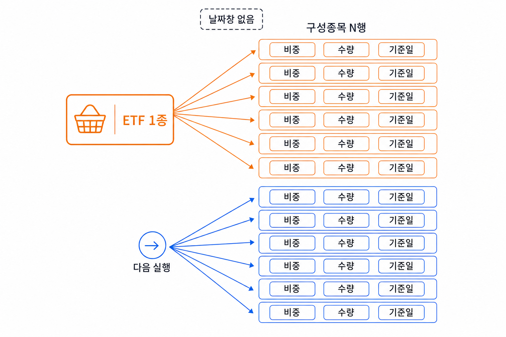
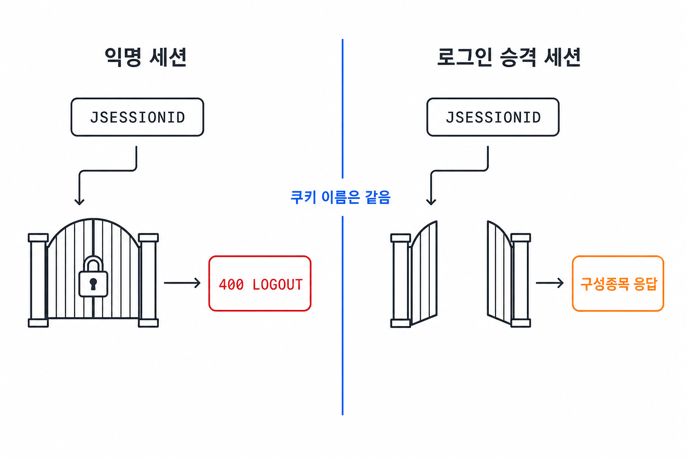
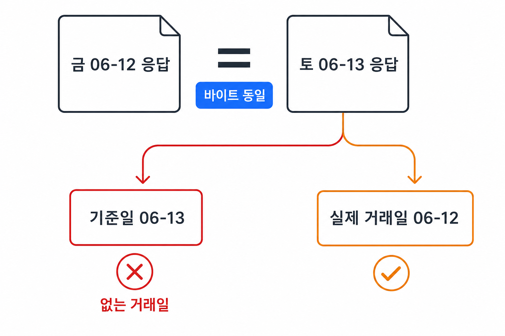

국내 ETF의 가격 변동을 설명하려면 수십에서 수백 개에 이르는 구성종목과 각 종목의 비중을 알아야 했다.

ETF 구성종목(holdings) 수집부터 시작했지만, 당시 확인한 국내 공식 API로는 필요한 구성종목 전량을 받을 수 없었다. KRX 정보데이터시스템 웹의 구성종목 조회(PDF) 화면을 이용하려면 로그인이 필요했다.

화면을 열 때 받은 쿠키를 붙여 요청해도, 로그인하지 않은 세션으로는 데이터를 받을 수 없었다.

로그인을 통과한 뒤에는 받은 데이터의 기준일을 확인해야 했다. 인증된 요청이 성공해도 그 응답이 실행일의 데이터라는 보장은 없었다.

## 구성종목은 기준일의 전량 스냅샷으로 받는다 {#구성종목은-날짜창이-아니라-전량-스냅샷으로-왔다}

뉴스는 날짜 범위 안의 신규분만 받는 증분 수집이 가능하다. 구성종목은 ETF 하나를 요청할 때마다 `trdDd` 한 날짜의 전체 구성종목을 받는다.

미국과 국내 소스를 나란히 놓으면 이렇다.

| 항목 | FMP 미국 ETF | KRX 국내 ETF |
|------|--------------|--------------|
| 호출 방식 | ETF 심볼로 `GET` | ISIN으로 `POST` |
| 엔드포인트 | `/stable/etf/holdings` | `/comm/bldAttendant/getJsonData.cmd` |
| 요청 단위 | ETF 1종당 1회 | ETF 1종당 1회 |
| 날짜창 | 없음 | 없음, `trdDd` 한 날짜를 지정 |
| 기준일 | 응답의 `updatedAt` | 요청의 `trdDd`를 raw의 `trd_dd`로 보존 |
| 인증 | API 키 | 로그인으로 승격한 세션 |

미국은 쉬웠다. FMP라는 벤더가 엔드포인트 하나로 구성종목 전량을 준다. 그래서 한국도 공식 API 하나 찾으면 될 줄 알았는데, 그게 아니었다.

파이프라인은 두 단계로 나눴다. 받은 값을 그대로 쌓는 raw와, 벤더별 필드를 공통 형태로 맞추는 canonical이다. 수집(raw)은 손대지 않고 보존하는 데까지만 책임진다. 응답 행에 "어느 ETF의 것인지", "언제 받았는지" 같은 수집 메타만 붙여서 실행마다 따로 쌓아둔다.

해외를 기초로 하는 ETF는 구성종목은 오는데 비중과 금액 필드가 `-`로 관측됐다. 이걸 수집 단계에서 0으로 채우거나 행을 버리지 않고, raw에는 대시 그대로 보존한다. 비중이 없다고 행을 버리면 구성종목 일부가 누락되므로, 값을 어떻게 처리할지는 canonical에서 정한다.


_ETF 한 번의 요청은 구성종목 N행으로 갈라지고, 다음 실행도 현재 바구니 전량에서 다시 시작한다_

## 문제 1. 같은 JSESSIONID인데 400 LOGOUT이 났다

가격 수집에 쓰던 KIS로 ETF 구성종목을 실제로 호출해보니, 전량이 아니라 상위 일부만 왔고 기준일 필드도 없었다. 구성 스냅샷이 아니라 실시간 시세용 엔드포인트라 그렇다.

당시 확인한 KRX 공식 OpenAPI에서는 구성종목 서비스를 찾지 못했고 일별 시세만 받을 수 있었다. 확인한 두 API 모두 필요한 구성종목 전량을 제공하지 않았다.

그래서 KRX 정보데이터시스템 웹의 구성종목 조회(PDF) 화면을 사용했다. 브라우저로 열면 전 종목 구성과 비중이 다 나온다. 브라우저가 그 화면을 열 때 보내는 요청을 확인했다.

개발자 도구를 켜고 보니 화면은 `MDCSTAT05001`이라는 서비스에 요청을 보내고 있었다. 요청 본문에 ETF의 12자리 표준코드(ISIN)인 `isuCd`, 6자리 단축코드인 `isuCd2`, 기준일인 `trdDd`를 넣고, `Referer`와 `X-Requested-With` 같은 헤더를 함께 보내고 있었다.

### 시도 1 — 로더 페이지의 익명 세션으로 데이터만 요청했다

처음에는 화면을 열 때 받은 쿠키(`JSESSIONID`)를 데이터 요청에 다시 붙이면 될 것으로 생각했다.

쿠키 이름도 맞고 헤더도 맞췄는데 돌아온 건 `400 LOGOUT`이었다.

처음에는 쿠키를 더 정확히 재현하는 문제인 줄 알았다. 하지만 같은 이름의 쿠키라도 로그인 전 세션과 로그인된 세션은 서버가 다르게 취급했다.

PDF 데이터를 받으려면 쿠키 값이 가리키는 서버 세션이 로그인 상태여야 했다. 서버는 로그인 요청을 처리한 뒤 해당 세션에 데이터 조회를 허용했다.


_쿠키 이름이 같아도 로그인으로 승격된 세션만 구성종목 게이트를 통과한다_

### 채택 — 익명 세션을 로그인 상태로 승격했다

브라우저의 로그인 요청을 확인해 코드로 재현했다. 로그인은 두 단계로 진행됐다.

```text
GET  /contents/MDC/COMS/client/view/login.jsp?site=mdc
  └─ 익명 JSESSIONID 확보

POST /contents/MDC/COMS/client/MDCCOMS001D1.cmd
  └─ 같은 쿠키를 이어받아 mbrId·pw 전송 → 세션 승격
```

먼저 로그인 페이지를 열어 익명 세션을 받고, **같은 쿠키로** 아이디·비밀번호를 보내면 서버가 그 세션을 로그인 상태로 바꾼다.

`Set-Cookie`를 직접 파싱해 옮기는 대신, `CookieJar`가 두 요청의 쿠키를 이어받게 했다. 로그인은 실행당 두 요청뿐이라, 공용 HTTP 클라이언트를 확장하지 않고 로그인 경로만 별도 opener로 분리했다.

로그인이 성공하면 응답 코드가 `CD001`로 온다. 이 코드를 확인한 뒤 로그인된 세션으로 요청하니 구성종목 전량을 받을 수 있었다.

로그인은 실행마다 한 번만 하고, 여러 ETF를 수집하는 동안 같은 세션을 재사용했다.

### 한계 — 같은 계정으로 동시에 로그인할 수 없다 {#한계--계정-동시-세션은-코드로-못-없앤다}

이 계정은 동시에 한 세션만 로그인할 수 있다. 파이프라인이 로그인해 있는데 사람이 같은 계정으로 또 로그인하면, KRX가 중복 로그인(`CD011`)으로 막는다.

배치가 장 마감 직후에 실행되므로 사람이 같은 계정에 접속하는 시간과 겹칠 수 있었다. 이 계정은 파이프라인 전용으로 정하고, 사람은 로그인하지 않기로 했다.

## 문제 2. 주말 응답이 금요일과 바이트까지 같았다

인증을 해결한 뒤에는 기준일을 확인했다. KRX는 요청에 `trdDd`를 직접 넣어야 하고, 응답에는 데이터의 기준일이 따로 표시되지 않았다. 수집기가 요청 날짜를 잘못 고르면 저장한 스냅샷에도 잘못된 날짜가 붙을 수 있었다.

### 시도 1 — 실행한 날짜를 그대로 기준일로 붙였다

제일 단순한 선택은 "오늘 실행했으니 오늘 날짜를 붙이자"였다. 거래일에는 이게 맞았다.

문제는 비거래일이었다. 정기 스케줄은 평일 15시 40분이라 주말엔 자동으로 돌지 않지만, 수동으로 검증하다 토요일에 받은 응답이 금요일 응답과 바이트 단위로 같다는 것을 발견했다.

당시 응답은 에러나 빈 배열이 아니라 금요일과 같은 구성종목 데이터였다. 실행일을 기준일로 붙이면 토요일 데이터로 잘못 표시되므로, 자동 실행되는 평일 휴장일에도 같은 라벨링 문제를 고려해야 했다.

HTTP 200만 확인해서는 이런 기준일 오류를 찾을 수 없었다.

### 버린 접근 — 빈 응답을 기다리며 날짜를 거꾸로 재시도하지 않았다

처음엔 비거래일이면 빈 응답이 올 거라고 봤다. 빈 배열이 나오면 날짜를 하루씩 뒤로 물려 재시도하는 방법을 생각했다. 그런데 6월 13일 토요일 응답은 비어 있지 않았다. 742행이 왔고, 금요일 응답과 md5가 같았다. 응답이 비어 있지 않아 재시도가 시작되지 않으므로, 요청 전에 기준일을 정하는 방식을 바꾸기로 했다.

### 채택 — 거래일 달력으로 기준일을 역산했다

기준일을 실행한 날이 아니라 실제 거래일로 되돌렸다. 오늘부터 하루씩 뒤로 가면서 처음 만나는 거래일을 기준일로 쓴다.

```python
for back in range(MAX_LOOKBACK_DAYS):
    day = today - timedelta(days=back)
    if is_trading_day(day):
        return day
raise ValueError("OPS_KR_HOLIDAYS 주입 확인")
```

오늘이 거래일이면 오늘, 주말이나 휴장일이면 직전 거래일을 쓴다. 토요일에 실행해도 금요일 데이터를 금요일 기준으로 저장할 수 있다. 뒤로 열흘까지 찾아도 거래일이 없으면 휴장일 설정 오류로 보고 실패시킨다.


_직전 거래일 데이터를 실행일 기준일로 라벨하면 실제로 열리지 않은 날짜의 스냅샷이 생긴다_

주말은 요일로 판정하고, 평일 휴장일은 목록(`OPS_KR_HOLIDAYS`)으로 주입받는다. 목록에 있으면 거래일이 아니라고 본다.

실행 계획을 짜는 쪽도 "오늘이 거래일인가"를 판단하므로 두 곳의 기준을 맞춰야 했다. 이 둘이 서로 다른 휴장일 목록을 보면, 한쪽은 휴장일이라 건너뛰는데 다른 쪽은 거래일로 라벨하는 모순이 생긴다. 그래서 두 쪽이 같은 목록을 보게 묶었다.

### 한계 — 휴장일 목록은 해마다 손으로 채워야 한다

주말은 코드가 요일로 알지만, 평일 휴장일은 `OPS_KR_HOLIDAYS` 목록으로 주입한다. 거래소 달력과 자동으로 연결된 구조가 아니라서, 목록을 갱신하지 않으면 실행 계획과 수집기가 나란히 같은 잘못된 날짜를 거래일로 판단한다. 목록에 오타가 있어도 해당 휴장일을 거래일로 판단할 수 있다. 두 곳이 같은 달력을 쓰더라도 목록을 해마다 갱신하고 확인해야 한다.

## 마무리

처음에는 로그인을 재현하면 수집이 끝날 것으로 생각했지만, 받은 데이터에 어떤 기준일을 붙일지도 따로 확인해야 했다. `400 LOGOUT`은 세션을 로그인 상태로 만들어 해결했고, 주말의 200 응답에는 거래일 달력으로 구한 기준일을 붙였다.

세션은 한 번 로그인한 뒤 재사용하고, 수집기와 실행 계획은 같은 휴장일 목록을 참조하도록 했다. 이후에도 계정의 중복 로그인을 피하고 휴장일 목록을 갱신해야 이 수집 방식을 유지할 수 있다.
