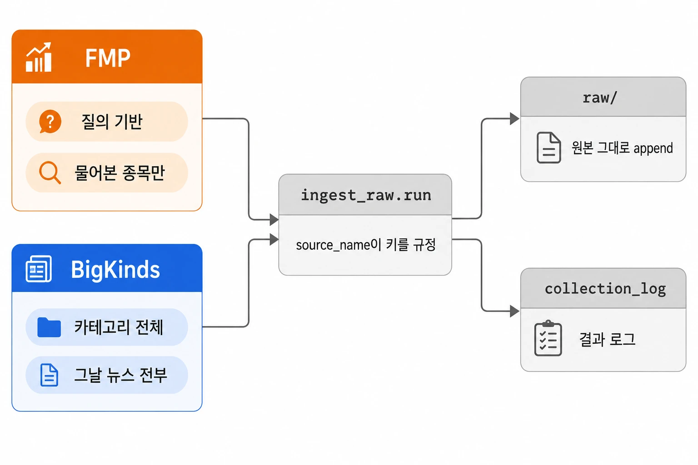
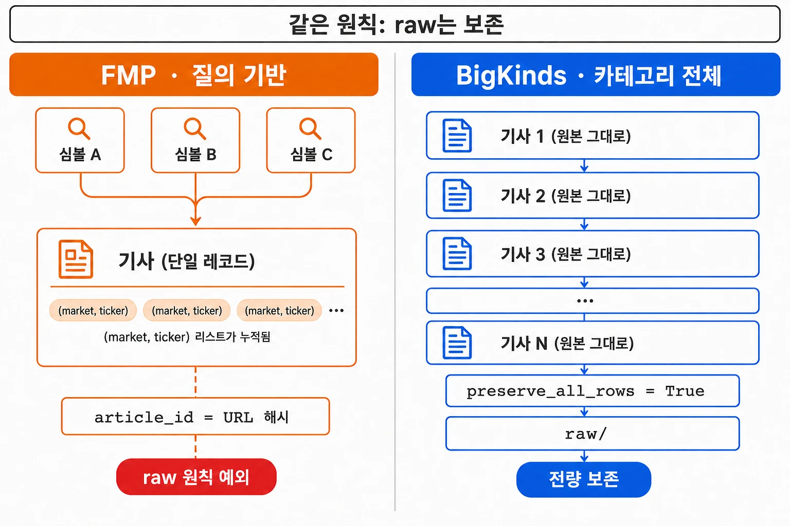
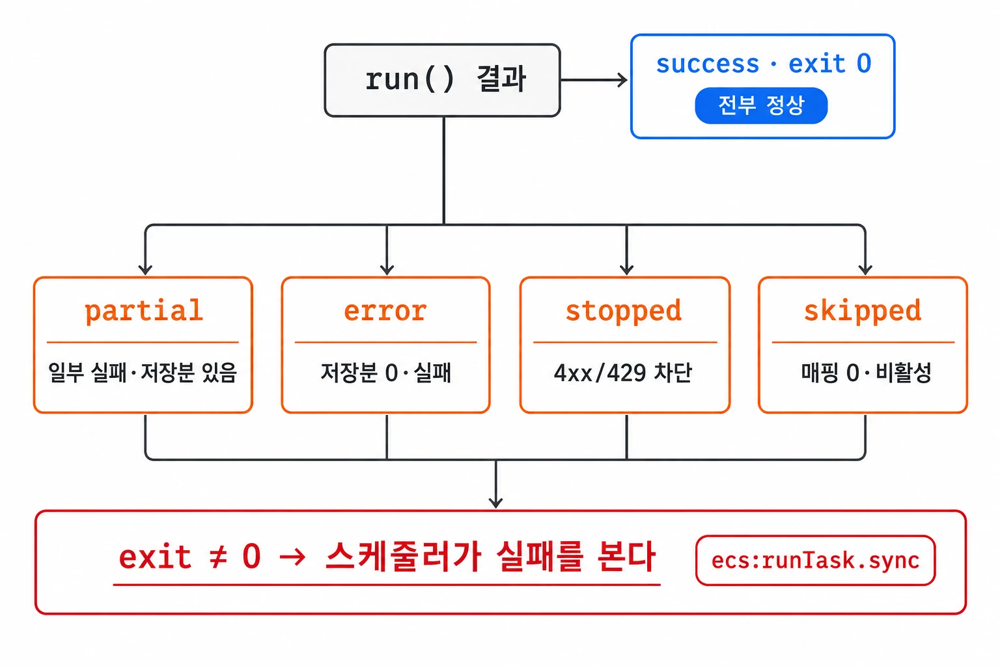

Python 워커를 ECS Task로 실행하고 Step Functions로 순서를 관리하는 구조를 만든 뒤, 뉴스 원본을 raw 존에 저장하는 수집 스텝을 구현했다.

막상 짜려니 "수집이 성공했다"가 정확히 뭔지 정의가 없었다. 뉴스 소스는 둘(FMP·BigKinds)인데 수집 방식이 서로 달랐고, 컨테이너 종료와 수집 성공도 구분해야 했다. 당시 `ecs:runTask.sync` 구성에서는 컨테이너의 non-zero 종료가 상위 태스크 실패로 반영되지 않아, "다 받아서 저장했다"로 끝내면 조용한 실패를 그대로 흘려보내는 셈이었다.

수집 결과를 판단하려면 원본 저장 규칙과 실패 기록을 함께 정해야 했다. 소스별 병합 범위, 부분 실패 상태, 페이지 상한에 걸린 결과의 처리 방식을 정했다.

## 두 소스가 한 스텝을 쓰는데 수집 계약은 서로 달랐다

수집 스텝(`ingest_raw.run`) 하나에서 FMP의 종목별 뉴스와 BigKinds의 경제 카테고리 뉴스를 받는다. 조회 범위가 달라 저장할 때 보존해야 하는 정보도 달랐다.


_수집 방식이 서로 다른 두 소스가 같은 한 스텝을 지나 raw와 collection_log로 갈라진다._

### FMP — 질의 기반이라 "물어본 종목의 뉴스"만 온다

FMP는 종목 식별자인 심볼로 뉴스를 조회하는 소스다. 수집 대상 종목 집합을 유니버스라고 부른다.

`plan()`이 유니버스 심볼을 FMP 심볼로 매핑(`symbol_map`)하고, 매핑이 없는 종목은 그냥 제외한다 — 오류가 아니라 후속 소스가 커버할 몫으로 넘기는 것이다. 이후 심볼마다 [from, to] 날짜 창을 page 0부터 순회하며 받는다.

그래서 FMP가 raw로 가져오는 건 "내가 이름을 대고 물어본 종목의 뉴스"다. 어느 종목 질의로 걸려 왔는지 이 소스는 안다.

### BigKinds — 카테고리 전체 수집이라 "그날 경제 뉴스 전부"가 온다

BigKinds는 다르게 설계했다. 검색어 없이(`searchKey=""`) 경제 대분류 카테고리의 그날 뉴스 전체를 날짜창 페이지네이션으로 받는다.

종목별 검색어를 쓰지 않기로 한 이유는, 종목 질의가 유니버스와 어긋나기 때문이다. 질의 맵에 있는 종목만 걸리고, 유니버스가 바뀌면 과거로 소급도 안 됐다.

BigKinds의 역할은 "그날 경제 뉴스 전체"를 raw로 보존하는 것 하나다. 한 기사에 종목 연결이 붙지 않는다.

## 질의 기반 소스에서는 기사와 종목 연결을 함께 보존했다

raw 존의 기본 원칙은 **원본 무변형 append**다. 받은 그대로 아무것도 바꾸지 않고 run_id별로 쌓기만 한다. 이 기록을 정제 로직을 다시 실행할 때의 입력으로 사용한다.

그런데 FMP에서 이 원칙을 그대로 지킬 수가 없었다.


_같은 "raw는 보존" 원칙에서 질의 기반 FMP만 mention을 병합하고 BigKinds는 전량 보존으로 간다._

### 원본 보존 — 뒤 단계의 처리를 다시 실행할 기준을 남긴다

정제 로직에 오류가 있으면 raw를 입력으로 다시 실행한다. 이를 위해 수집 단계에서는 받은 내용이 정제 결과로 덮어써지지 않도록 한다.

### FMP 예외 — 같은 기사가 여러 심볼에 걸려서 mention을 병합한다

FMP는 심볼마다 따로 질의하니 같은 기사가 여러 종목 질의에 중복으로 걸려 온다. 애플과 마이크로소프트를 같이 언급한 기사는 두 질의 모두에서 온다. 그대로 append하면 같은 기사가 여러 벌 쌓인다.

그래서 FMP에서만 **한 실행 안의 중복 제거(dedup)**을 켰다. 새 record를 버리는 대신 그 `(market, ticker)` 종목 연결(mention)을 기존 record에 병합한다. 키는 article_id, 원문 URL의 해시다.

종목 연결은 질의 기반 소스에서 확보하는 정보다. 이 연결을 raw에서 남기지 않으면 정규화 단계에서 복원할 방법이 없다.

### BigKinds — preserve_all_rows로 병합을 끈다

BigKinds에는 종목 연결이 없다. 카테고리 전체 수집이라 한 row가 한 기사이고, 병합해서 보존할 mention도 없다. 그래서 BigKinds는 `preserve_all_rows = True`로 dedup·병합을 끄고 전량 보존한다.

### 미래 경계 — 소스가 늘면 preserve_all_rows 플래그로 계약을 분기한다

지금은 소스가 둘이라 병합을 켤지 끌지가 눈에 보인다. 소스가 더 늘면 이 판단을 매번 코드로 분기하기 어렵다. 그래서 병합 여부를 소스별 `preserve_all_rows` 플래그로 뺐고, BigKinds가 그 첫 케이스다.

## collection_log에 성공과 나머지 네 상태를 구분해 남겼다

배치 작업의 결과는 보통 성공 아니면 실패, 둘 중 하나로 본다. 그런데 이 스텝에선 그 이분법이 금방 부족해졌다.


_성공은 exit 0 하나뿐이고 나머지는 partial·error·stopped·skipped 네 상태로 남아 exit code에 진실을 싣는다._

### 부분 수집 — 받은 데이터와 실패한 요청을 함께 기록한다

한 종목 질의가 실패해도 나머지 종목은 멀쩡히 받았으니 수집 전체가 실패는 아니다. 그렇다고 일부를 못 받았는데 성공이라고 할 수도 없다.

부분 수집을 전체 실패로 처리하면 이미 받은 데이터를 버리게 되고, 성공으로 처리하면 실패한 요청을 구분할 수 없었다.

그래서 `run()`은 결과를 항상 `collection_log`에 상태로 남기도록 짰다. 성공이면 exit 0, 그 외에는 non-zero를 반환한다. 성공 외 상태는 네 가지다 — `partial`, `error`, `stopped`, `skipped`.

### 격리 가능한 실패와 전체 중단을 나눴다 — partial / error / stopped

심볼 단위 실패는 다른 심볼의 수집을 계속하면서 `fetch_failures`에 기록했다. 저장된 데이터와 실패 기록을 함께 보고 최종 상태를 판정한다.

저장분이 있는데 일부가 실패했으면 `partial`이다. 받긴 받았지만 온전하진 않다는 뜻으로 exit 1을 낸다. 저장분이 0인데 실패가 있으면 `error`, 수집이 사실상 실패한 것이다.

4xx나 429로 소스가 통째로 막히면(`StopFetch`) `stopped`로 남기고 exit 1을 낸다. 재시도가 소진되는 예기치 못한 실패도 그때까지 받은 부분을 저장한 뒤 `error`로 기록한다. raw 저장(`put_bytes`) 자체가 실패해도 예외를 삼키고 `error`로 남긴 뒤 로그를 쓴다.

### 아무것도 안 한 것도 드러낸다 — skipped는 success(0)로 위장하지 않는다

활성 소스라도 매핑 대상이 0개라면 수집을 실행하지 못한 상태다. 이를 수집을 마쳤지만 결과가 0건인 경우와 구분해야 했다.

그래서 이 경우를 `skipped`로 따로 남긴다. 소스가 아예 비활성(키 미주입, 로컬 실행 등)이어도 마찬가지로 `skipped`를 로그로 드러낸다.

### 로그를 못 써도 exit code는 남긴다 — ECS가 성공이라 답하기 전에

당시 `ecs:runTask.sync` 구성에서는 상위 태스크 상태만으로 컨테이너의 non-zero 종료를 구분할 수 없었다. 워커의 exit code를 상위 오케스트레이션에서 확인해야 했다.

그 연장에서 `collection_log` 쓰기 자체가 실패해도(스토리지 통째 장애) 최소한 non-zero로 종료해 스케줄러에 알리도록 했다. 감사 로그는 유실되더라도 "실패했다"는 신호는 exit code로 반드시 나간다.

### 미래 경계 — 지금 status를 읽는 건 SFN Choice 하나뿐이다

지금 이 네 상태를 실제로 소비하는 건 exit code를 읽는 Choice 분기 하나뿐이다. `status` 문자열 자체를 읽는 소비자는 아직 없다. 나중에 운영 원장이나 대시보드가 `partial`·`skipped` 같은 status를 직접 집계하기 시작하면, 상태 구분이 지금 이 정도로 충분한지 다시 봐야 한다.

## 페이지 상한에 걸려 잘려도 실패가 아니라 성공으로 봤다

페이지 상한에 도달하면 요청한 날짜 창의 일부만 수집된 상태가 된다. 이 스텝에서는 받은 데이터를 저장하고, 절단 여부는 수집 상태와 별도로 기록했다.

### 절단 처리 — 받은 데이터는 저장하고 수집 범위는 별도로 확인한다

심볼·창당 페이지 안전 상한을 뒀다 — FMP는 `MAX_PAGES=50`, BigKinds는 config로 받는다. 창 하나가 상한에 걸려 잘려도 이미 받은 데이터는 그 자체로 유효하다. status 판정에서는 절단을 `real_failure`에서 빼고 성공으로 취급한다.

### 대신 truncation 로그를 남긴다 — 조용히 버리지 않는 게 핵심

상한에 도달하면 `kind="truncation"` 로그를 남겨 전체 범위를 수집하지 못했음을 표시한다.

이 표기는 수집 범위가 잘렸다는 신호다. 다음 날짜 창만으로 누락분이 채워진다고 볼 수 없으므로, 누락 범위를 확인해 해당 구간의 재수집 여부를 정해야 한다.

### BigKinds는 조기종료를 일부러 안 쓴다 — soft cap이 성공으로 위장되니까

BigKinds에선 흔한 최적화 하나를 일부러 뺐다. 보통 `len(rows) < page_size`면 마지막 페이지로 보고 조기종료하는데, BigKinds는 이걸 쓰지 않는다. `page_size`가 API 상한(100)에 붙어 있어서 서버가 **soft cap**이나 자체 dedup으로 페이지를 적게 채워주는 일이 있다.

짧은 페이지를 마지막으로 판단하면 뒤에 남은 기사를 수집하지 못한다. 그래서 `isLimitPage`나 빈 페이지 같은 명시적인 신호로 종료하도록 했다.

### 미래 경계 — 창이 계속 절단되면 상한을 튜닝한다

지금은 `MAX_PAGES=50`이 창을 절단하는 일이 예외적이라는 전제 위에 서 있다. 특정 창이 반복적으로 절단된다면 상한이나 창폭이 데이터 양과 안 맞는다는 신호다. 그때는 `MAX_PAGES`나 날짜 창 폭을 튜닝해야 한다.

## 날짜가 없는 원본도 저장하고 정제는 canonical에서 처리했다

raw의 원칙은 전부 보존이라 한 레코드도 못 버린다. 그런데 파티션을 발행일(`published_date`)로 나누다 보니 발행시각이 없거나 파싱이 안 되는 레코드가 문제였다. 파티션 키가 비면 그 레코드는 어디에도 들어가지 못하고 런 전체를 죽일 수 있었다.

### 파티션 폴백 — 발행일이 없을 때 사용할 날짜를 정한다

그래서 파티션 키에 **폴백**을 세 단으로 깔았다. `published_date`가 없으면 수집시각(`fetched_at`), 그마저 없으면 런 시작일로 내려간다.

```
파티션 basis:  published_date → fetched_at → 런 시작일
              (하드 서브스크립트 basis[:10])
```

문자열의 앞부분을 `basis[:10]`으로 잘라 파티션 날짜로 사용한다. 날짜의 정합성을 검사하는 것은 다음 정규화 단계의 역할이다. 이렇게 저장한 raw는 경로 규약을 따른다. ndjson으로 쓰되 `ensure_ascii=False`로 한글 원문을 그대로 보존한다.

```
raw/source={vendor}/dataset=stock_news/market={market}/published_date=.../run_id=.../part-00000.ndjson
operations_archive/collection_logs/source={vendor}/dataset=stock_news/started_date=.../run_id=...
```

경로 규약과 실제 저장 위치는 lake의 `storage.py`가 단일 출처로 규정한다.

### 정제는 여기서 안 한다 — 런 간 중복도 정합성도 canonical 단계 소관

런 안에서는 FMP의 mention을 병합하지만, 서로 다른 런에서 수집한 중복은 canonical 단계에서 병합한다. raw는 `run_id`별로 기록을 추가한다.

발행일 정합성 검사 같은 것도 정규화 게이트 소관이라 이 스텝에선 하지 않는다. 수집 단계는 원본 저장을 맡고 canonical에서 정제와 검증을 수행하도록 역할을 나눴다.

## 마무리

FMP는 기사에 연결된 종목을 병합하고 BigKinds는 받은 행을 그대로 보존했다. 수집 결과에는 성공 외에도 네 상태를 두고, 페이지 상한에 도달한 경우는 별도 로그로 기록했다.

처음에는 `partial`이나 `skipped` 같은 상태가 과하게 느껴졌다. 하지만 당시 실행 환경에서 컨테이너 실패가 상위 태스크 실패로 나타나지 않는 것을 확인한 뒤, 수집 결과와 종료 코드를 워커에서 명시적으로 남기도록 했다.

raw에 보존한 데이터의 정규화와 정합성 검사는 다음 단계인 canonical에서 수행한다.

## 참고 자료

아래는 구현 당시 본문에서 참조한 코드 위치다.

- fmp.py:77-89
- fmp.py:129-176
- bigkinds.py:1-14, 123-145
- ingest_raw.py:7
- ingest_raw.py:80-106
- ingest_raw.py:80-82 주석
- bigkinds.py:36
- ingest_raw.py:92-94
- ingest_raw.py:50
- fmp.py:49-51, 91-98
- ingest_raw.py:131-149
- ingest_raw.py:108-111
- ingest_raw.py:112-116
- ingest_raw.py:118-129
- ingest_raw.py:148-149, fmp.py:52-54, 115
- ingest_raw.py:67-78
- ingest_raw.py:151-171
- fmp.py:25
- ingest_raw.py:134-137
- fmp.py:169-175, bigkinds.py:117-121
- bigkinds.py:110-116
- ingest_raw.py:29-39
- ingest_raw.py:124
- storage.py:27-33, 526-534
- ingest_raw.py:7, 46-47
- ALPHA-351: 절단 처리와 수집 창 설계의 기존 참고 항목
