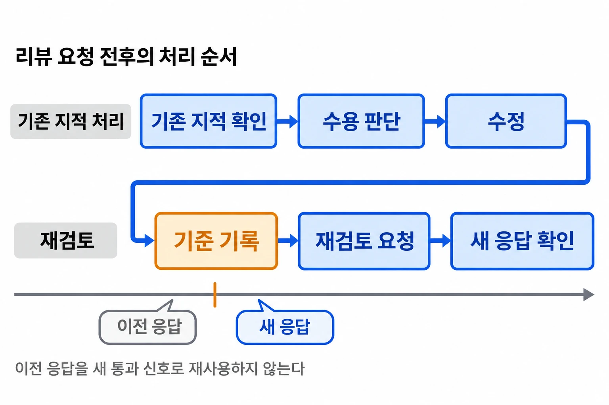

EDGE에서는 데이터 수집 코드뿐 아니라 스키마, API와 인프라 설정도 함께 바뀐다. 코드 한 파일에서 문제가 없어 보여도 테이블 소유권이나 수집 결과의 상태 규약을 어기면 다른 모듈이 잘못된 전제로 데이터를 읽을 수 있다.

팀에는 브랜치 생성부터 PR 제출까지 이어주는 작업 절차가 있었다. 여기에 프로젝트 계약을 검사하는 `edge-review`를 추가하고, PR에 달린 지적을 읽어 수용 여부를 판단한 뒤 수정과 재검토까지 이어지는 절차를 만들었다. Skill은 에이전트가 따라야 할 범위와 순서, 판단 기준을 저장소의 Markdown 파일로 관리하는 방식이다.

이전 리뷰의 통과 표시가 남아 있고, 같은 지적도 후속 커밋 이후 여전히 유효할 수 있었다. 리뷰 결과를 어떤 변경에 대한 응답으로 읽을지, 수정할 지적이 없으면 언제 끝낼지를 절차에 명시했다.

## 데이터 계약을 읽고 변경된 코드와 대조하게 했다
{: #project-contract-review }

범용 버그 검사에는 조건식, 예외 처리와 호출부의 전제 변화가 들어갔다. 그 위에 EDGE의 규약을 적용했다. 예를 들어 한 테이블을 소유한 모듈만 쓰도록 정했다면, 스키마 파일이 그대로여도 다른 앱에서 새로 추가한 `INSERT`를 살펴봐야 한다.

그래서 변경 파일의 경로만으로 검사 대상을 고정하지 않았다. DB 쓰기 코드가 바뀌면 스키마 계약을, API가 바뀌면 접근 경계를, 수집 코드가 바뀌면 원본 보존과 결과 상태 규약을 함께 읽도록 했다. 규칙 본문은 Skill에 복사하지 않고 `AGENTS.md`와 설계 결정 문서를 참조하게 해, 규약과 검사 지시가 서로 다른 내용을 갖지 않도록 했다.

| 변경 대상 | 함께 확인할 코드와 규칙 | 검토할 실패 경로 |
|---|---|---|
| DB 쓰기 코드 | 테이블 소유 모듈, 스키마 계약 | 소유하지 않은 모듈이 데이터를 변경하는가 |
| API와 Gateway | 읽기 전용 경로, 인증과 테넌트 경계 | 쓰기 경로가 열리거나 다른 테넌트의 데이터가 노출되는가 |
| 데이터 수집·정제 | 원본 보존, 수집 로그와 상태 의미 | 처리하지 못한 결과를 정상 0건으로 기록하는가 |
| 인프라 또는 클라우드 API 호출 | 부여한 권한과 실제 호출 코드 | 권한 부족이 대체 경로에 가려지는가 |

마지막 행은 후속 보완이다. 팀원의 Glue 연동 변경에서 실제 호출에 필요한 권한이 빠졌고, 호출 예외 뒤 대체 경로로 진행하면 실행 자체는 성공할 수 있다는 사례를 확인했다. 내 변경은 그 연동 구현이 아니라, IAM 정책과 이를 사용하는 애플리케이션 코드를 함께 대조하도록 검사 기준을 추가한 것이다.

이때 검사 시작 조건도 넓혔다. Terraform 파일이 그대로여도 앱이 새로운 AWS API를 호출하면 필요한 권한이 달라질 수 있기 때문이다. 인프라 diff 안에서만 찾는 검사로는 반대 방향의 변경을 놓친다.

검사에 넣을 변경 범위도 구분했다. PR에 이미 커밋한 코드, 아직 커밋하지 않은 추적 파일, 새로 만든 미추적 파일은 서로 다른 명령으로 확인해야 했다.

```bash
git diff dev...HEAD
git diff HEAD
git ls-files --others --exclude-standard
git status --short
```

당시 Skill에 넣은 범위 수집 명령이다. 앞의 두 diff에 나타나지 않는 미추적 파일도 목록을 얻어 직접 읽도록 했으며, 파일 이름만 확인한 상태를 코드 검사 완료로 취급하지 않았다.

## 리뷰 결과를 후속 처리할 수 있는 형태로 받았다
{: #structured-findings }

처음에는 에이전트가 검사 관점별로 후보를 찾고 검증하도록 구성했다. 이후 실행을 Codex CLI로 옮기면서도 프로젝트 계약과 검증 기준은 지시문에 유지했다. 이 변경의 목적은 리뷰 결과에 파일과 줄 위치, 실패 조건을 남겨 수정과 댓글 처리에 사용할 수 있게 하는 것이었다.

각 지적에는 위치, 심각도, 요약과 `failure_scenario`를 요구했다. 어떤 입력이나 실행 순서에서 문제가 생기는지 설명하게 했다. 결과는 JSON 스키마로 형태를 정하고, 파싱 뒤 필요한 필드와 판정값을 확인하도록 했다.

```json
"verdict": {
  "type": "string",
  "enum": ["CONFIRMED", "PLAUSIBLE", "REFUTED"]
}
```

실제 출력 스키마의 판정 필드다. 확인된 문제, 가능성이 남은 문제, 코드로 반증한 후보를 구분하며 반증한 후보는 최종 지적에서 제외한다.

전환 과정에서는 지시와 스키마가 어긋난 부분도 고쳤다. 검증 단계에는 후보를 반증하라고 지시하면서 스키마에는 `REFUTED`가 없었다. 스키마에도 `REFUTED`를 추가해 반증한 후보를 반환할 수 있게 했다.

결과 파일도 실행마다 새로 만들도록 했다. 고정 경로를 재사용하면 리뷰 실행이 실패했을 때 이전 실행의 빈 지적 목록을 읽을 위험이 있다. 종료 코드 확인과 함께 JSON 파싱·스키마 검사를 두고, 후속 변경에서는 파일의 존재와 비어 있지 않음까지 성공 조건에 명시했다.

후속 보완의 계기는 사용 한도 오류를 출력하면서 종료 코드가 0인 관측이었다. 다만 그 전에도 JSON 파싱과 스키마 검증 지시는 있었다. 기존 절차가 종료 코드만 보고 통과했다거나, 이 보완으로 실제 결함이 줄었다고 해석하지 않는다.

코드 읽기와 테스트 실행도 구분했다. 리뷰 실행에는 읽기 전용 옵션을 명시했고 빌드와 테스트, 수용한 지적의 수정은 이를 호출한 작업 절차에서 수행하게 했다. 모델의 코드 검토 결과와 실제 테스트 통과는 별도로 확인할 항목이었다.

## 기존 지적과 새 리뷰 응답을 나누어 처리했다
{: #review-response-loop }

PR에 달린 지적을 반영할 때는 이미 있는 지적을 읽고 시작해야 한다. 새 응답을 기다리는 기준 시점부터 잡으면 사용자가 처리하려던 기존 지적까지 과거 기록으로 묶여, 아무 수정도 하지 않은 채 다음 응답을 기다릴 수 있다.

반대로 수정 후 재검토를 요청할 때는 이전 통과 표시를 다시 쓰면 안 된다. 리액션과 댓글은 PR에 남으므로 새 커밋이 올라와도 예전의 `+1`이 존재할 수 있다. 재검토 요청 직전에 리액션, 리뷰와 봇 댓글의 현재 상태를 기록하고 그 이후의 신호를 읽도록 했다.

기록 순서도 중요했다. 요청을 보낸 뒤 기준을 기록하면 그 사이에 도착한 빠른 응답까지 기존 신호로 분류한다.


_수용한 지적을 수정한 뒤, 재검토 요청 전에 이전 응답을 구분할 기준을 기록한다_

기존 지적 중 무엇이 남아 있는지 판단하는 방법은 다시 고쳤다. REST 댓글을 전부 읽으면 해결된 지적을 재처리한다. 현재 HEAD 커밋에 달린 댓글만 남기면 후속 커밋이 해당 코드를 건드리지 않아 아직 유효한 지적도 빠진다.

최종적으로는 리뷰 스레드의 해결 여부와 더 이상 현재 코드에 대응하지 않는지 여부를 사용했다. 해당 봇의 지적 중 `isResolved`와 `isOutdated`가 모두 false인 것을 처리 대상으로 삼았다.

| 기존 지적의 상태 | HEAD와 같은 커밋인가 | 처리 대상 |
|---|---|---|
| 미해결이며 현재 코드에 유효 | 같음 | 포함 |
| 미해결이며 현재 코드에 유효 | 다름 | 포함 |
| 해결됨 | 무관 | 제외 |
| 후속 변경으로 오래된 지적이 됨 | 무관 | 제외 |

이 기준을 적용한 뒤 수용할 지적이 있으면 수정과 재검토로 진행한다. 모든 지적을 비수용하면 이유를 반환하고 종료한다. 아무것도 바꾸거나 요청하지 않았는데 새 응답만 기다리는 경로를 없앤 것이다.

지적을 수용하지 않을 때는 실제 오류나 계약 위반인지, 이번 변경에서 의도적으로 제외한 요구인지 검토한 이유를 남긴다. 호출한 절차는 통과 여부와 비수용 목록을 받아 다음 작업을 판단한다.

## 독립 호출에서는 수정할 브랜치도 확인했다
{: #branch-and-exit-conditions }

리뷰 대응은 처음에는 PR 생성 절차 안에 들어 있었다. 이를 `codex-review-loop`로 분리하면 이미 열린 PR의 지적만 반영할 때도 사용할 수 있다. 대신 PR 생성 단계가 보장하던 작업 브랜치를 독립 호출에서도 확인해야 했다.

수정 커밋 전에 PR의 head 브랜치와 현재 로컬 브랜치가 같은지 대조하도록 했다. 다른 경우에는 자동으로 브랜치를 바꾸지 않고 중단한다. 작업트리의 무관한 변경도 확인하고, 커밋에는 수정 대상 파일만 포함하도록 했다.

브랜치 생성·커밋·병합과 리뷰 응답 처리는 바뀌는 이유가 다르다. 봇의 응답 형식이나 재검토 방식이 바뀌면 리뷰 대응 Skill을 고치고, 저장소의 브랜치 정책이 바뀌면 이를 호출하는 작업 절차를 고칠 수 있게 나눴다.

내가 맡은 범위는 프로젝트 특화 검사, PR 이후 지적 판단과 재검토 연결, CLI 실행과 구조화 출력 전환, 리뷰 대응 Skill의 분리와 보완이다. 초기 PR 작업 절차와 이후 PR 전 로컬 반복 검토 확장은 팀원이 구현했다.

## 후속 검증에서 선택 규칙과 출력 계약을 확인했다
{: #validation-and-limits }

당시 Skill의 선택 규칙을 작은 함수로 옮긴 오프라인 검사를 2026년 11월 13일 다시 실행했다. 미해결·해결·오래된 스레드, 현재·이전 커밋, 사람 댓글을 조합한 7개 입력이다. 당시 AI 세션을 재실행한 것은 아니며, 문서에 적힌 조건이 어떤 대상을 선택하는지 확인하는 검사다.

REST 댓글을 모두 선택하는 규칙은 제외해야 할 항목 4개를 포함했다. HEAD 커밋만 선택하는 규칙은 2개를 잘못 포함하고 유효한 지적 1개를 놓쳤다. 스레드 상태를 사용하는 규칙은 이 7개 입력의 기대값과 일치했다.

출력 스키마도 당시 수정 전후 파일로 대조했다. `CONFIRMED`, `PLAUSIBLE`, `REFUTED`, 잘못된 판정값을 넣어 보니 수정 후에는 반증 결과를 표현할 수 있었고 잘못된 값은 계속 거부했다. 이는 출력 형식의 검사이며 모델이 실제 결함을 정확히 판단한다는 검증은 아니다.

조회 범위의 한계도 남았다. 당시 Skill의 GraphQL 예시는 리뷰 스레드를 `first:100`으로 읽고 다음 페이지를 처리하지 않았다. 해결된 스레드 100개 뒤에 미해결 지적 1개를 둔 합성 입력에서는 그 지적을 읽지 못한다. 실제 프로젝트에서 발생한 누락 사례로 주장할 수는 없지만, 선택 조건이 맞아도 조회 범위 밖의 지적은 놓칠 수 있음을 보여준다.

공동 저장소 반영과 팀원의 후속 개선 기록은 확인했다. 다만 기록을 비교해도 리뷰 왕복 감소나 팀 생산성 향상을 입증하지 못했다.

## 마무리

프로젝트 규약을 검사에 넣으려면 어떤 변경에서 어떤 계약을 읽을지 연결해야 했다. DB 쓰기 코드와 소유권, 클라우드 API 호출과 권한처럼 파일 밖의 전제를 확인하는 기준을 Skill에 남겼다.

리뷰 지적을 처리하는 과정에는 결과의 최신성, 출력 계약, 브랜치와 종료 조건이 필요했다. 어떤 댓글이 아직 유효한지와 어떤 응답이 새 요청에 대한 것인지도 서로 다른 기준으로 다뤘다.

합성 입력에서는 선택 규칙이 기대대로 동작했지만, 조회 범위를 넘은 지적은 여전히 놓칠 수 있었다. 검사 기준을 추가한 뒤에도 입력을 빠짐없이 읽었는지와 모델의 판단이 맞는지는 따로 확인해야 한다.

## 참고 자료

- [프로젝트 특화 edge-review 추가](https://github.com/alphaeveryday/edge/commit/ab1d8f25e)
- [PR 생성 후 지적 판단과 재검토 연결](https://github.com/alphaeveryday/edge/commit/303d08d0b)
- [CLI 실행과 JSON 출력 스키마 전환](https://github.com/alphaeveryday/edge/commit/6892ca49f)
- [리뷰 대응 Skill 분리와 활성 스레드·브랜치·종료 조건 보완](https://github.com/alphaeveryday/edge/commit/283b54a95)
- [권한과 실제 API 호출의 대조 기준 추가](https://github.com/alphaeveryday/edge/commit/d6377a697)
- [리뷰 출력 파일의 존재와 내용 확인 보완](https://github.com/alphaeveryday/edge/commit/6ec8d47f4)
