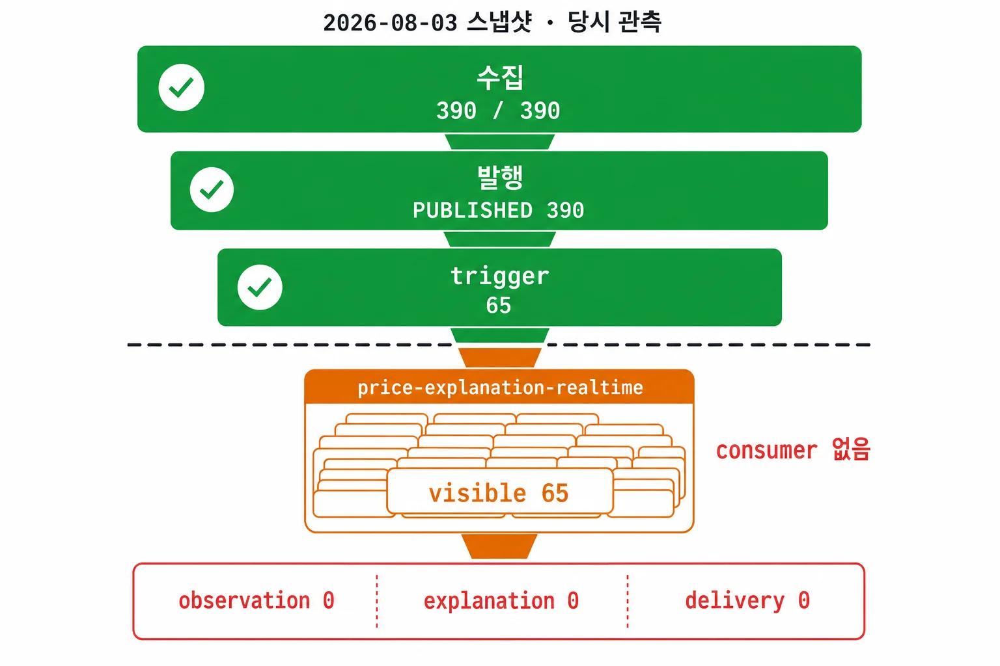
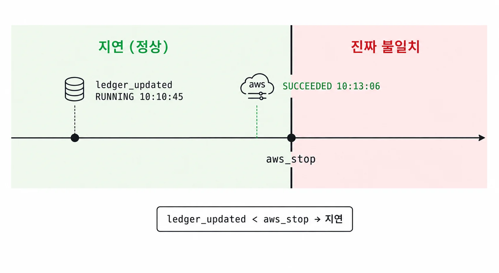
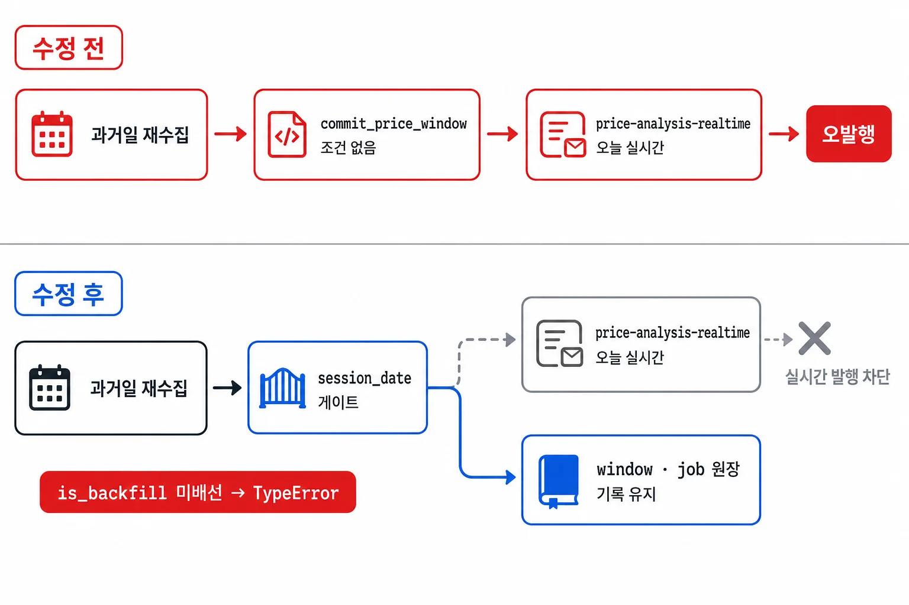
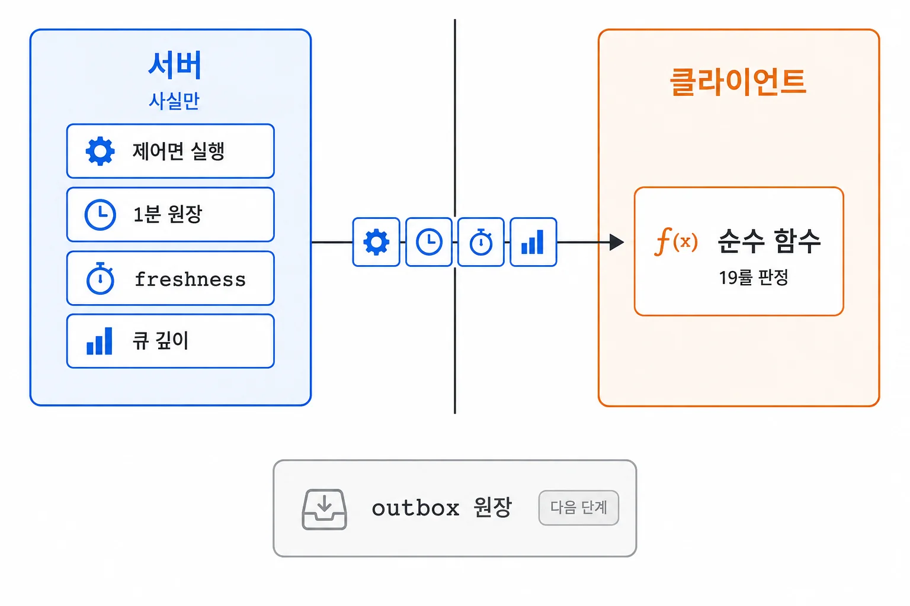

직전 작업에서는 DB 기록과 메시지 발행이 따로 성공하는 문제를 outbox로 다뤘다. 워커는 DB에 job과 발행 의도를 남기고, 발행은 별도 Relay가 `NEW` event를 SQS로 보내며 `PUBLISHED`로 바꿨다. 앞선 로컬 장애 주입 측정에서 publisher 경계까지의 유실은 0이었다.

어느 날 콘솔을 열었더니 위에서 아래까지 전부 초록이었다. 발행은 하나도 실패하지 않았는데, 정작 그날 나갔어야 할 설명은 한 건도 나가지 않았다.

`PUBLISHED`를 처리 완료로 잘못 읽고 있었다. 발행 성공은 그 메시지가 SQS에 실렸다는 것뿐, 메시지를 받아 업무를 수행하는 consumer가 그 일을 끝냈다는 게 아니었다.

그래서 하나로 뭉쳐 보던 파이프라인을 수집·발행·큐에 쌓인 대기 작업(queue backlog)·consumer 처리·최종 결과 다섯 단계로 갈라 각각의 기록으로 세기 시작했다.

## 발행 성공(PUBLISHED)과 업무 완료는 다른 사건이었다

콘솔에는 수집과 발행이 성공으로 표시됐지만, 그 뒤의 처리 상태는 나타나지 않았다.

### 삽질 — 전부 초록인데 설명 대기가 65건, 분석이 0이었다

2026-08-03 dev 스냅샷을 뜯어보다 이상한 걸 봤다(당시 관측). 장중 1분 price 세션은 하루치 window **390**개를 전부 처리했고(당시 관측 381 VALID, 9 VALID_EMPTY, 무증거 0), price job도 390개, `price-analysis-realtime` outbox도 390개가 전부 `PUBLISHED`였다.

여기서 390은 그날 하루치 정상 window 수다. 381 VALID에 9 VALID_EMPTY, 무증거 0이라 빠진 window가 없다는 뜻이고, 수집 390도 발행 390도 전부 이 한 벌을 가리킨다. 두 390이 같은 08-03 날짜를 달고 있어 날짜만으로는 어느 단계 것인지 안 갈린다.

price consumer가 이 분석들을 받아 장중 trigger 65개를 만들었고, 그 trigger를 깨울 outbox event 65개도 전부 SQS 발행에 성공했다.

끊긴 곳은 그 다음이었다. trigger를 받아 실제 설명을 만들 `price-explanation-realtime` 큐에는 visible message가 65개 쌓여 있는데, 그 큐를 소비할 consumer 서비스가 terraform에도 코드에도 없었다. DB funnel로 세어보니 trigger 65 → observation 0 → explanation 0 → delivery 0이었다.

Outbox의 `PUBLISHED`는 [Relay가 event를 SQS에 보내고 발행 상태를 갱신했다는 것](https://jingi723.github.io/posts/edge-outbox/)을 기록한다. Consumer가 업무를 끝냈는지는 별도 기록으로 확인해야 했다.

수집 성공 390건과 함께 설명 대기 65건, 분석 0건을 표시해야 했다. 이후에는 outbox의 `PUBLISHED`를 처리 성공으로 표시하지 않도록 했다.


_설명 대기 65건이 있어도 consumer가 없으면 최종 결과는 생성되지 않는다_

## 수집부터 최종 결과까지 단계별로 집계했다

수집, 발행, queue backlog, consumer 처리, 최종 결과를 다섯 단계로 나누고, 각 단계의 기록을 따로 집계했다.

이렇게 갈라두니 단계마다 다른 대응이 붙었다. queue backlog를 따로 세는 게 특히 값졌는데, 그 뒤 이 큐를 소비할 consumer가 배포되면서 backlog 깊이를 신호로 0~4대까지 자동 확장하게 했다. 설명 한 건에 중앙값 588초가 걸려서, 하루 42~65건이 몰리면 1대로는 6시간 넘게 밀리고 수동 확장은 공유 RDS를 고갈시켰기 때문이다.

### 집계 대상 — 같은 날의 트리거에서 시작한 결과를 따라간다

단계마다 날짜를 따로 적용하면 서로 다른 날에 시작된 작업을 함께 비교하게 된다.

오늘 발행된 설명 중에는 어제 trigger된 게 섞이고, 오늘 trigger된 것 중 일부는 아직 설명이 안 된다. 각 단계를 자기 날짜로 필터하면 분자와 분모가 서로 다른 작업 집합이 된다.

그래서 facts 응답의 날짜 축을 트리거 하나로만 뒀다. 그날 트리거된 것만 날짜로 고르고, observation·explanation·delivery는 그 트리거의 자손을 LEFT JOIN으로 따라가 셌다. 전 단계를 DISTINCT로 묶어, 테넌트가 둘이면 전달이 설명의 두 배로 부풀어 보이는 잠복 결함도 미리 없앴다.

## DB 원장의 실행 상태를 Step Functions 기록과 대조했다

단계별 집계에 사용하는 DB 원장의 실행 상태도 AWS 기록과 대조할 필요가 있었다.

같은 08-03 스냅샷에 답이 있었다. 15:40 market 실행은 AWS Step Functions 정본이 **FAILED**인데, 내 DB 투영은 16:20이 되도록 **RUNNING**으로 남아 있었다(당시 관측). AWS 실행 상태와 DB 기록이 40분 넘게 달랐다.

어긋나는 건 구조 때문이었다. 실행의 정본은 AWS Step Functions이고, 내 DB 원장은 그 상태를 복사해 저장한 조회용 기록이다. 이렇게 원본 상태를 다른 형태로 옮겨 둔 것을 투영이라고 한다. 둘을 이어주는 Reconciler가 15분 주기로 돌면서 AWS 실행 상태를 읽어 원장에 반영한다.

그러니 원장은 마지막 대조가 돈 시점까지만 최신이다. AWS에서 상태가 바뀌고 다음 대조 tick이 오기 전까지는, 원장이 설계상 뒤처져 있다.

다만 40분 넘게 어긋난 사례의 원인을 15분 주기만으로 설명할 수는 없었다. 정기 갱신 사이의 지연과 그보다 길게 지속된 차이는 나눠 봐야 했다.

### 삽질 — 15분 주기 상태 갱신의 지연이 거짓 경보가 됐다

그래서 Step Functions를 직접 대조하기로 했다. Reconciler가 `DescribeExecution`으로 AWS 실행 상태를 가져와 내 원장과 맞춰봤다.

근데 대조하자마자 거짓 경보가 쏟아졌다. 실측한 한 실행은 원장이 `RUNNING`(10:10:45)인데 Step Functions는 이미 **SUCCEEDED**(10:13:06)였다.

이건 진짜 불일치가 아니었다. Reconciler가 15분 주기로 도니까, 내 원장이 아직 `SUCCEEDED`를 반영 못 한 몇 분짜리 투영 지연을, 대조기가 불일치로 오해한 것이었다.

### 지연과 진짜 불일치를 시간으로 가른다 — ledger_updated < aws_stop

정상 지연과 진짜 불일치를 가를 기준이 필요했다. 시각을 쓰기로 했다.

대조할 때 AWS 실행이 끝난 시각(`aws_stop`)을 같이 실었다. 내 원장이 갱신된 시각이 `aws_stop`보다 이르면(`ledger_updated < aws_stop`) 아직 투영이 안 따라온 지연이고, 그게 아니면 진짜 불일치였다.

Step Functions 조회가 `AccessDenied`로 막히면 제어면 조회 결과 전체를 비웠다. 일부만 조회된 결과를 전체 상태로 해석하지 않도록 하기 위해서였다.


_원장 갱신이 aws_stop보다 이르면 아직 안 따라온 지연이고 늦으면 진짜 불일치다._

## 과거일 재수집이 실시간 분석을 발행하지 않도록 분리했다
{: #historical-backfill-publishing }

과거일 분봉을 보완하는 작업에서도 실시간 분석 이벤트가 생성되고 있었다. 데이터를 저장하는 일과 그 데이터로 실시간 판정을 요청하는 일에 같은 조건을 적용한 것이 문제였다.

### 삽질 — 과거일 재수집에서 실시간 판정 이벤트 390건이 발행됐다

가격 window를 확정하는 `commit_price_window`는 조건 없이 outbox event를 냈다. 그게 실시간 커밋이든 과거일 백필 커밋이든 가리지 않았다.

과거일을 다시 수집하는 backfill 커밋도 Relay를 거쳐 `price-analysis-realtime`으로 전달됐다. 소비자는 해당 세션에 저장된 기준 가격을 읽으므로, 재수집 가격과 그 시점의 기준 가격 상태에 따라 의도하지 않은 트리거나 분석을 만들 위험이 있었다.

커밋 기록에는 2026-08-08에 8월 3일 데이터를 재수집하다 발생한 사건으로 남아 있다. 실시간 분석 event **390**건이 잘못 발행됐고, 그걸 손으로 DEAD 격리했다(당시 관측, 커밋 본문 기준). 이 수치는 이벤트 수이며 최종 분석 완료나 고객 노출 건수는 확인하지 못했다.

### session_date — 과거일에는 산출물만 남기고 실시간 발행을 막는다

처음에는 벤더나 소스 종류로 걸러보려 했지만, 같은 소스도 과거일을 다시 수집할 수 있으므로 세션 날짜로 구분해야 했다.

워커를 시작할 때 `session_date`가 한국시간의 오늘보다 과거인지 판단하고, 그 결과를 `is_backfill`로 커밋까지 전달했다. `emit_outbox=not is_backfill`로 발행 여부를 결정한다. 같은 당일 세션의 누락 구간을 채우는 recovery 작업은 과거일 백필과 다르므로 이 조건만으로 발행을 막지 않는다.

한 가지는 일부러 안전하게 실패하도록 뒀다. `is_backfill`에 기본값을 두지 않아서, 어디선가 이 값을 배선하는 걸 빠뜨리면 조용히 통과하는 대신 `TypeError`로 죽게 했다. 값 누락을 실행 시점에 확인하려는 의도였다.

대신 window와 job 원장은 백필에서도 그대로 남겼다. 백필이 무엇을 수집했는지는 기록으로 남기되, 실시간 판정 event만 만들지 않는 것이다. 초기 기록에는 변이 5종 검증과 2,183개 테스트 통과가 있지만, 후속 리뷰에서는 CLI가 `is_backfill=False`를 고정해서 넘겨도 그 테스트들이 통과한다는 빈틈을 찾았다. 과거일과 당일의 CLI 배선을 각각 검사하고, 과거일 종단 경로의 발행 0건과 필수 인자에 기본값이 없다는 조건을 추가했다. 테스트 수만으로 호출부까지 보호됐다고 볼 수 없었다.

과거일에는 정정된 가격의 재판정 이벤트도 만들지 않는다. 과거 데이터를 다시 분석하려면 별도의 발행 경로가 필요하며, job을 직접 가져가는 소비자를 추가한다면 이벤트 생성만 막는 이 조건도 다시 검토해야 한다.


_실시간이냐 과거냐를 벤더가 아니라 session_date로 가르자 과거일 커밋은 원장만 남고 실시간 발행은 막혔다._

## 빈 결과와 관측 실패를 구분했다

조회에 실패했을 때와 조회 결과가 비었을 때 모두 `0`이나 빈 배열(`[]`)을 반환하면, 두 상태를 구분할 수 없었다.

### 부재 표기 여섯 갈래 — 0 / — / 관측 불가 / 계측 없음 / VALID_EMPTY / MISSING

그래서 부재를 한 표기로 접지 않고 여섯 갈래로 나눴다.

| 표기 | 뜻 |
|---|---|
| `0` | 관측 결과가 실제로 0 |
| `—` | 집계가 없음 |
| `관측 불가` | 접근 채널이 없음 |
| `계측 없음` | 기록 자체가 없음 |
| `VALID_EMPTY` | 실행됐고 결과가 0 (돌았다는 증거) |
| `MISSING` | 실행 증거 또는 기대 데이터가 없음 (증거 부재) |

`VALID_EMPTY`는 실행됐고 결과가 비었다는 뜻이며, `MISSING`은 실행 증거 자체가 없다는 뜻이다. 두 값을 합치면 실행 여부를 확인할 수 없는 경우까지 정상적인 빈 결과로 집계하게 된다.

### 없는 분모로 성공률을 만들지 않는다 — TagNews 64는 BigKinds 4,000의 분자가 아니다

비율을 계산할 때는 분자와 분모가 같은 작업 집합을 나타내는지도 확인해야 했다.

뉴스 수집이 딱 그랬다. BigKinds 최신 수집은 status `success`에 records 4,000이었지만 `MAX_PAGES`(40) 절단으로 `INCOMPLETE`였고, 그날 TagNews로 새로 태깅된 건 64건이었다.

언뜻 64/4,000 같은 비율을 만들고 싶어지지만, **64**는 4,000의 분자가 아니다. 실제 분해는 read 9,532 / already-tagged 3,568 / no-mention 5,900 / newly-tagged 64였고, 64는 그중 마지막 갈래일 뿐이었다.

load counter도 같은 함정이었다. `LOAD_ETF_HOLDINGS`의 `records_out` 10,289에 `failed` 2,415가 찍혀 있어도, 이건 당일 raw 906행의 분자·분모가 아니라 누적 재판정 범위였다. "2,415 / 12,704 = 일일 유실률" 같은 비율을 만들지 않았다.

### 조회 실패는 [] 대신 null — 일부 큐가 안 보이면 큐 축 전체를 비운다

SQS 큐 깊이를 관측할 때 일부 큐만 조회한 결과를 전체 결과로 반환하면, 조회하지 못한 큐가 표시에서 빠질 수 있었다.

그래서 일부 큐가 안 보이면 큐 축 전체를 `null`로 접었다. `SqsQueueControlPlane`은 한 큐라도 조회에 실패하면 부분 성공을 전체 관측처럼 내보내지 않고 축을 통째로 비웠다.

`[]`를 반환하면 규칙 엔진은 큐가 없다고 해석해 `평가됨·위반 0`으로 처리할 수 있었다. 조회 실패에는 `null`을 반환해 평가하지 못한 상태로 남겼다.

지금은 이 표기 규칙과 클라이언트 판정으로 충분하다. 원장이 제대로 된 분모를 줄 때에야 진행률이나 완전성 집계로 넘어갈 수 있다.

## 운영 조회 API는 사실을 제공하고 클라이언트가 상태를 판정했다
{: #minute-status-api }

운영 상태 API는 보통 서버가 상태를 평가해서 "정상 / 경고 / 오류"를 내려준다. 화면은 그 판정을 그대로 그리면 되니 편하다.

API는 원장 값과 무증거·lease 만료 같은 파생 사실을 제공하고, 화면의 정상·경고·오류 규칙은 프론트의 순수 함수에서 평가하도록 했다(ADR-0050). 내가 구현한 범위는 조회 API와 집계 조건이며, 화면 전체와 분석 모델의 오류 진단을 모두 만든 것은 아니다.

### 조회 대상 — 실행 상태·1분 원장·데이터 최신성·큐 깊이

Java·Spring Boot로 짠 조회 API가 주는 건 넷이다. AWS 제어면 실행 상태, 1분 원장, 데이터가 얼마나 최신인지, 그리고 SQS 큐 깊이.

콘솔 진입점은 `GET /api/v1/console/facts`다. `ConsoleController`의 javadoc에 "응답은 사실이고 위반 목록이 아니다"라고 못박아뒀다. `date`를 안 주면 원장이 아는 가장 최근 날을 주되, 그게 거래일이라는 보장은 하지 않는다.

실시간 1분 축은 `/api/v1/sources/minute`으로 따로 뒀다. `JdbcMinuteStatusRepository`가 session의 phase와 `expected_window_count`·`processed_through`, window 판정 카운트, 무증거 술어, gaps, price job, news job을 준다.

장 종료 후 품질 검사가 붙이는 `MISSING`만 세면, 장중에 수집이 멈춰도 누락 0건으로 보일 수 있다. 그래서 수집할 시각이 지났는데 완료 증거도 유효한 실행 권한도 없는 구간을 `overdue_no_evidence`로 따로 집계했다. 실행 권한인 lease가 남아 있다면 아직 정상 처리 중일 수 있다.

조회 SQL은 다음 조건을 집계와 근거 목록에서 함께 사용한다.

```sql
((w.data_status = 'DUE'
  OR (w.data_status = 'CLAIMED'
      AND (w.lease_expires_at IS NULL OR w.lease_expires_at < now())))
 AND w.scheduled_at <= now())
```

예정 시각이 지난 `DUE`, 또는 같은 시각 조건에서 lease가 만료됐거나 없는 `CLAIMED`가 대상이다. 아직 수집 예정 시각 전인 구간, 유효한 lease로 처리 중인 구간, 수집을 마쳤지만 결과가 빈 `VALID_EMPTY`는 제외한다. 단순히 분봉 구간이 끝났는지가 아니라 실제 수집 가능 시각인 `scheduled_at`을 기준으로 삼는다.

시계는 데이터를 쓰는 쪽과 같은 DB의 `now()`를 사용했다. 상태 조회 메서드에는 읽기 전용 `REPEATABLE_READ` 트랜잭션을 적용해 집계와 상세 목록을 같은 스냅샷에서 읽는다. 조회 사이에 워커가 결과를 저장하더라도, 한 응답 안에 서로 다른 시점의 집계와 목록이 섞이지 않게 한 것이다.

`processed_through`와 `contiguous_complete_through`도 구분한다. 최근에 처리한 구간이 뒤쪽에 있어도 앞쪽에 빠진 구간이 있다면 연속으로 완료한 지점은 그보다 앞에 머문다. 최신 처리 시각 하나로 시작부터 빠짐없이 수집됐다고 판단하지 않도록 두 값을 제공했다.

통합 테스트에는 기한이 지난 `DUE`와 lease가 없는 `CLAIMED`를 넣고, 유효한 lease·빈 결과·미래 예정 구간을 함께 둔다. 이때 `MISSING`은 0이어도 무증거 집계와 목록에는 해당 두 구간이 남도록 검사한다. 이 테스트는 조회 판정의 포함·제외 조건을 검사하며, AWS 장애 재현이나 운영 성능을 측정한 결과는 아니다.

후속 구현은 price job에 커밋 당시의 발행 필요 여부인 `delivery_expected`도 저장한다. 발행이 필요한 대기 job의 이벤트가 없거나 `DEAD`이면 전달 실패로 세되, 의도적으로 이벤트를 만들지 않은 과거일 job은 같은 오류로 세지 않는다. 재수집의 발행 조건이 조회 API의 판정에도 이어져야 했다.

| 조회 축 | 주는 것 |
|---|---|
| 제어면 실행 | Step Functions 실행 상태·`aws_stop` |
| 1분 원장 | session·window·job·gaps |
| freshness | `stck_bsop_date` 증거 |
| 큐 깊이 | visible·in-flight·DLQ |


_서버는 사실만 넘기고 정상·경고·오류 판정은 클라이언트 순수 함수가 하며 outbox 원장은 아직 이 축 밖이다._

### 클라이언트 판정 — 규칙을 한곳에서 관리한다

판정을 클라이언트에 둔 이유는 기존 로직의 위치와 규칙 변경 주기 때문이었다.

첫째, 실시간 축이 이미 클라이언트에서 평가 중이었다. 여기서 콘솔 판정만 서버로 올리면 같은 시스템의 판정 로직이 서버와 클라 두 곳으로 갈라진다.

둘째, 규칙이 아직 흔들리는 단계였다. 콘솔 규칙 엔진은 화면 구조가 바뀔 때마다 같이 흔들려서 9라운드 동안 16룰에서 19룰로 늘었다. 규칙이 이렇게 자주 바뀌는데 서버에 두면, 룰 문구 한 줄 고칠 때마다 배포가 따라붙는다.

원래 이 19룰의 입력은 앱 번들 안에 박아둔 정적 `facts-snapshot.json`(2026-08-03 스냅샷)이었다. ADR-0050에서 이걸 실제 응답으로 교체해, 화면이 박제된 스냅샷이 아니라 그날의 사실을 보고 판정하게 했다.

규칙과 화면 구조가 안정되면 서버에서 평가하는 방식을 다시 검토할 수 있다.

### freshness는 완전성과 다른 축 — 완전성 VALID여도 STALE일 수 있다

데이터가 얼마나 최신인지는 완전성과 아예 다른 축이었다. window가 전부 `VALID`로 채워졌어도 그 안의 데이터는 며칠 전 것일 수 있고, 반대로 `INCOMPLETE`여도 있는 데이터는 최신일 수 있다.

그래서 freshness를 요청일이나 실행일로 추정하지 않았다. KIS 응답에 실제로 찍혀 오는 영업일 증거(`stck_bsop_date`)로만 판정하게 했다(ADR-0043). 실행일이나 파티션 날짜로 넘겨짚으면 오래된 데이터에 거짓 `FRESH`가 붙는다.

증거가 없거나 손상됐으면 `FRESH`도 `STALE`도 아닌 **UNKNOWN**으로 보존했다. KRX holdings가 그 극단이었다. 이 소스는 데이터가 언제 기준인지 말해주는 독립 as-of 증거 자체가 없어서, 어쩌다 한 번이 아니라 언제 조회해도 판정할 근거가 없다.

그래서 실행일로 추정하지 않고 설계상 영구 `UNKNOWN`(NULL)으로 남기도록 정했다(ADR-0043).

## 마무리

이번에 받아들인 건, 발행 성공(`PUBLISHED`)이 완료의 증거가 아니라는 사실이었다. 그건 메시지를 SQS에 실었다는 것까지만 참이고, 큐 반대편에서 그 일이 끝났는지는 다른 축으로 따로 세야 했다.

수집·발행·backlog·처리·결과를 각각 집계하고, 조회 실패와 실제 0건을 다른 값으로 표시했다. 조회 API가 이 기록을 제공하면 클라이언트에서 운영 상태를 판정하도록 구성했다.

처음에는 수집 성공 390건을 보고 지나쳤지만, 설명 대기 65건과 분석 0건을 함께 확인해야 소비 단계의 누락을 발견할 수 있었다.

조회 결과가 0인 경우와 조회하지 못한 경우를 구분해야, 장애가 없는 것인지 확인 자체가 안 된 것인지 판단할 수 있다.


## 참고 자료

- [장중 수집 상태 조회 구현과 통합 테스트](https://github.com/alphaeveryday/edge/commit/79aca7e5612e41c40df6aed7134ff535a49fbaa3)
- [과거일 분봉의 조건부 발행과 후속 리뷰 보완](https://github.com/alphaeveryday/edge/commit/1ef267baca1c573280dcf02fe7506f4c96c571cf)
- [후속 조회 SQL과 스냅샷 처리](https://github.com/alphaeveryday/edge/blob/21ace842b3f6f8a72a81d45fa62d645f0a31d935/apps/edgesignal/super-admin-api/src/main/java/com/edge/superadmin/repository/JdbcMinuteStatusRepository.java)

8월 개발 환경의 관측 기록과 11월 7일 코드까지 확인한 후속 구현을 구분했다. 현재 고객 운영 상태나 분석 품질을 검증한 글은 아니다.
