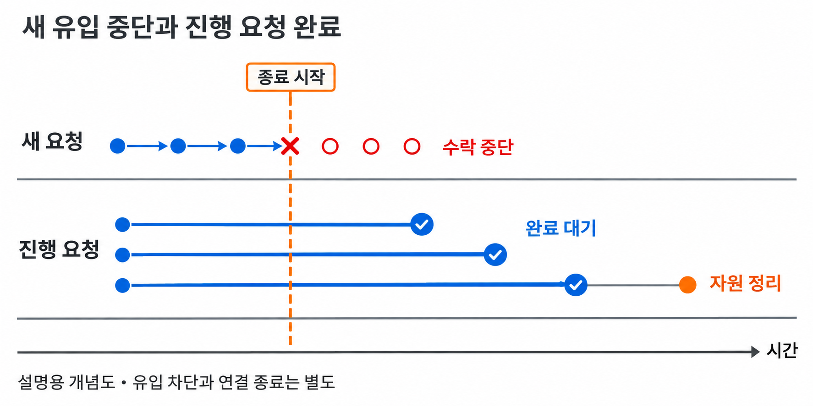
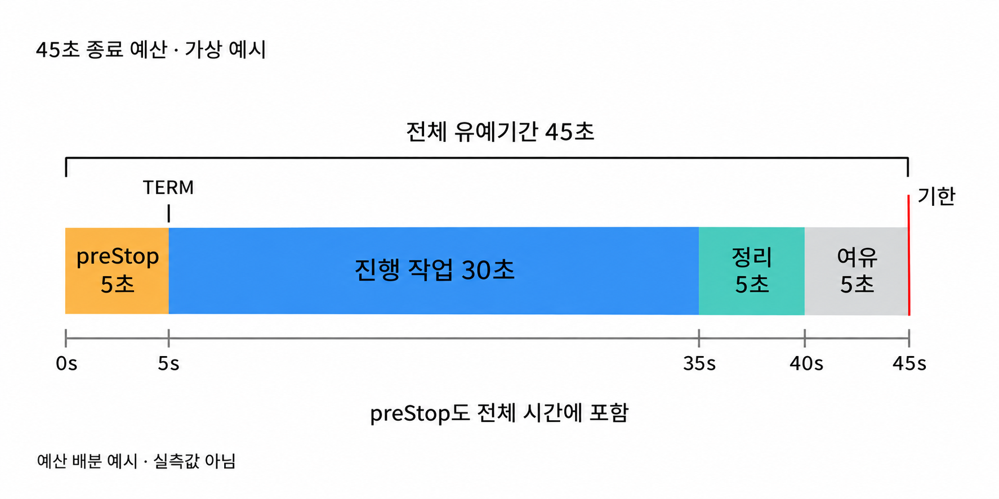
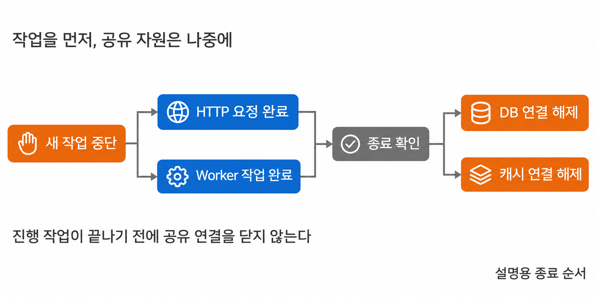
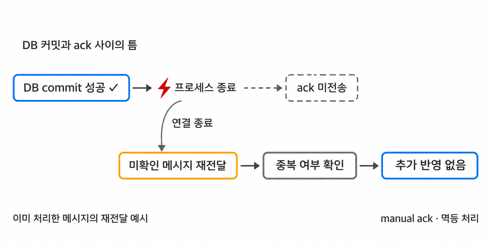

**Graceful Shutdown**은 새 작업의 유입을 멈추고, 이미 받은 작업을 정리한 뒤 프로세스를 종료하는 절차다. 배포나 인스턴스 교체로 서버가 내려갈 때 진행 중인 요청과 작업이 갑자기 끊기는 일을 줄인다.

종료는 운영 중 반복해서 발생하는 정상적인 과정이다. 그 순간에도 HTTP 요청이 응답을 기다리고, 작업자가 데이터베이스에 결과를 쓰고, 메시지의 처리 완료를 브로커에 알리고 있을 수 있다. 프로세스를 늦게 끄는 것만으로 이 작업들이 안전하게 끝나지는 않는다.

종료 절차에는 순서와 제한 시간이 함께 필요하다. 새 일을 받지 않는 시점, 진행 중인 일이 끝나는 시점, 연결과 자원을 해제하는 시점을 구분해야 한다. 제한 시간을 넘겨 강제로 종료되더라도 작업을 다시 처리할 수 있어야 전체 과정이 이어진다.

## 종료 신호를 받은 뒤에도 처리할 일이 남는다

컨테이너를 중지하면 런타임은 내부 프로세스에 종료를 요청한다. Docker의 일반적인 중지 흐름에서는 먼저 `SIGTERM`을 보내고, 정해진 유예 기간 안에 종료되지 않으면 `SIGKILL`을 보낸다. 처음 보낼 신호와 대기 시간은 설정에 따라 달라질 수 있다.

`SIGTERM`을 받은 애플리케이션은 등록된 종료 처리에 따라 요청 수신을 중단하고 자원을 정리할 수 있다. 신호를 받는다는 사실만으로 그런 절차가 생기는 것은 아니다. 애플리케이션과 프레임워크가 실제로 종료 동작을 구현하고 있어야 한다.

`SIGKILL`은 정리를 요청하는 단계가 아니다. 프로세스가 종료 코드를 실행할 기회 없이 중단되므로, 마지막 로그를 남기거나 처리 위치를 저장하는 동작에 의존할 수 없다. 정상적인 종료 경로를 설계하면서도 이 경로가 생략될 가능성을 함께 다룬다.

종료 코드가 있는데도 실행되지 않는다면 **신호가 애플리케이션까지 전달되는지** 확인해야 한다. 컨테이너의 주 프로세스가 셸이고 애플리케이션이 그 자식으로 실행되면, 셸이 받은 신호가 자식에게 전달되지 않을 수 있다. 컨테이너 안에서 누가 PID 1인지가 여기서 중요해진다.

Java 애플리케이션을 직접 실행한다면 다음과 같이 Dockerfile의 exec 형식을 사용할 수 있다. 아래는 Java와 `/app/app.jar`가 이미지 안에 준비되어 있다고 가정한 실행 구문이다.

```dockerfile
ENTRYPOINT ["java", "-jar", "/app/app.jar"]
```

이 구문은 중간 셸 없이 Java 프로세스를 컨테이너의 주 프로세스로 실행한다. 시작 스크립트가 필요하다면 마지막에 `exec java ...`로 셸을 교체하거나, 별도의 프로세스 관리자가 신호를 전달하도록 구성한다. 종료 훅을 추가하기 전에 신호가 도착할 경로부터 확인하는 이유다.

## 새 요청을 막고 처리 중인 요청을 먼저 끝낸다

서버가 종료 중인데 새 요청을 계속 받으면 끝내야 할 일이 줄지 않는다. 먼저 새 유입을 멈추고 이미 받은 요청을 비워 나가는 **drain** 단계가 필요하다. 영업을 마칠 때 새 손님을 받는 문은 닫되, 안에 있는 손님의 계산은 끝내는 것과 비슷하다.

HTTP 서버에서는 외부의 라우팅과 서버 내부의 수신 제어가 함께 움직인다. 로드 밸런서가 이 인스턴스를 새 요청의 목적지에서 제외하고, 애플리케이션도 종료 상태에 맞춰 새 요청을 받지 않도록 해야 한다. 두 조치는 서로 다른 위치에서 이루어진다.

readiness는 인스턴스가 새 트래픽을 받을 준비가 되었는지 나타내는 신호다. Kubernetes에서 종료 중인 Pod의 엔드포인트는 일반 트래픽 대상으로 쓰이지 않도록 상태가 바뀐다. 이 변경이 주변 라우팅 구성에 전파되는 과정과 Pod 내부의 종료 절차는 비동기로 진행된다.

따라서 readiness가 바뀐 순간 모든 요청이 끊긴다고 가정해서는 안 된다. 이미 전달 중인 요청이 있거나 기존 연결을 통해 요청이 도착할 수 있다. 라우팅 변경, 새 요청 수신 중단, 기존 요청 완료 사이에 어떤 일이 들어올 수 있는지 확인해야 한다.


_새 요청의 유입을 멈추는 시점과 기존 요청의 처리가 끝나는 시점은 다르다_

새 연결을 받지 않는 것과 기존 연결의 새 요청을 받지 않는 것도 구별한다. HTTP keep-alive나 HTTP/2처럼 연결을 재사용하는 경우에는 연결이 남아 있다는 사실만으로 그 안에서 새 요청까지 계속 처리해야 하는 것은 아니다. 서버와 앞단 프록시가 종료 중 연결을 어떻게 다루는지 함께 확인한다.

진행 중인 요청도 모두 같은 방식으로 기다릴 수는 없다. 짧은 조회는 응답을 마칠 때까지 기다릴 수 있지만, 스트리밍이나 장시간 유지되는 연결은 스스로 끝나지 않을 수 있다. 이런 연결에는 종료 안내, 재연결, 마지막 처리 위치 복원 같은 별도 규칙이 필요하다.

## 제한 시간은 전체 종료 절차를 담아야 한다

Graceful Shutdown은 무한히 기다리는 기능이 아니다. 종료를 요청한 쪽은 자원을 회수해야 하므로 애플리케이션 바깥에도 마감 시각이 있다. 내부의 대기 시간이 이 한도를 넘으면 진행 중인 정리 작업이 강제 종료로 끊긴다.

Kubernetes의 `terminationGracePeriodSeconds`는 Pod 종료에 주어지는 유예 기간이다. `preStop` 훅이 있다면 보통 그 실행이 끝난 뒤 종료 신호가 전달되지만, 유예 기간의 카운트다운은 훅이 시작되기 전에 이미 진행된다. **preStop 시간도 전체 종료 예산을 사용한다.**

가령 전체 유예 기간을 45초로 잡는 상황을 가정한다. `preStop`에 5초, 진행 중 작업에 30초, 연결과 자원 정리에 5초, 여유에 5초를 배정하면 총 45초다. 이는 관계를 설명하기 위한 가상 예산이며 측정 결과나 권장 기본값이 아니다.


_종료 전에 쓰는 시간과 작업을 마친 뒤의 정리 시간도 전체 제한 안에 포함해야 한다_

실제 예산은 요청과 작업의 최대 실행 시간, 외부 시스템의 응답 지연, 라우팅 전파 시간을 보고 정한다. `preStop`에 고정된 대기 시간을 넣는 것만으로 전파 완료가 보장되지는 않는다. 대기가 필요하다면 무엇을 기다리는지와 그 시간이 전체 예산에 미치는 영향을 확인해야 한다.

각 단계에 같은 대기 시간을 따로 부여하면 총시간이 예상보다 길어질 수 있다. 요청 종료에 30초를 기다린 뒤 작업자 종료에도 다시 30초를 기다리는 식이다. 전체 마감 시각을 기준으로 남은 시간을 계산해야 뒤 단계가 이미 소진한 시간을 다시 사용하는 일이 없다.

대기 시간을 늘리는 데에도 한계가 있다. 외부 호출의 타임아웃이 없거나 작업이 취소 요청에 반응하지 않으면 종료 시간을 길게 주어도 끝나지 않을 수 있다. 어떤 작업은 완료까지 기다리고 어떤 작업은 취소 후 재처리할지 먼저 정해야 예산에 의미가 생긴다.

## 웹 서버와 백그라운드 작업은 따로 종료해야 한다

Spring Boot 3.5에서는 웹 서버의 graceful shutdown 동작을 설정할 수 있다. 아래는 종료 정책과 종료 단계별 대기 시간을 명시한 `application.yml` 예시다. 30초는 예시 값이며 앞의 가상 예산에서 진행 작업에 배정한 시간과 같은 크기로 두었다.

```yaml
server:
  shutdown: graceful

spring:
  lifecycle:
    timeout-per-shutdown-phase: 30s
```

이 설정은 애플리케이션 컨텍스트가 닫힐 때 웹 서버의 정상 종료 절차를 사용하고, 종료 단계별 대기 시간을 지정한다. 이미 처리 중인 HTTP 요청에 완료 기회를 주며, 새 요청의 거절 방식은 내장 웹 서버에 따라 달라진다.

`timeout-per-shutdown-phase`는 이름 그대로 **각 종료 단계에 적용하는 제한**이다. 애플리케이션 전체가 반드시 30초 안에 종료된다는 뜻이 아니다. 여러 단계와 별도의 정리 동작이 있다면 전체 시간은 따로 계산해 컨테이너의 유예 기간 안에 들어가는지 확인해야 한다.

HTTP 요청이 끝나도 다른 실행 주체는 남을 수 있다. 메시지 소비자는 다음 메시지를 받을 수 있고, 스케줄러는 새로운 작업을 예약할 수 있으며, 애플리케이션이 만든 스레드 풀에는 대기 중인 작업이 있을 수 있다. 웹 서버 설정만 보고 이런 작업의 완료까지 보장된다고 판단해서는 안 된다.

| 실행 주체 | 먼저 멈출 유입 | 이미 시작한 작업의 종료 기준 |
|---|---|---|
| HTTP 서버 | 새 요청 수신 | 응답 완료 또는 정한 연결 종료 정책 |
| 메시지 소비자 | 새 메시지 전달·조회 | 처리와 확인 완료, 또는 재전달 가능한 상태 |
| 스케줄러 | 다음 작업의 실행 예약 | 실행 중 작업 완료 또는 취소 확인 |
| 내부 작업 큐 | 새 작업 등록 | 대기·실행 작업 완료 또는 복구 가능한 인계 |

메시지 소비자의 수신 중단과 실행 중인 작업의 중단도 다른 동작이다. 예를 들어 RabbitMQ에서 소비를 취소해도 이미 전달 중이던 메시지는 남을 수 있고, 이전에 전달된 미확인 메시지가 그 취소만으로 모두 재큐잉되지는 않는다. 수신 중단 이후에도 관리해야 할 작업의 범위를 명확히 잡아야 한다.

**의존 자원은 사용하는 쪽보다 나중에 닫는다.** HTTP 요청과 작업자가 데이터베이스를 쓰는 동안 커넥션 풀을 먼저 닫으면, 정상적으로 끝낼 수 있던 작업도 실패하게 된다. HTTP 서버와 작업자의 종료를 확인한 뒤 공통으로 쓰는 DB·캐시 연결을 정리하는 순서가 기본이다.


_공유 자원은 그 자원을 사용하는 마지막 작업이 멈춘 뒤 해제해야 한다_

내부 작업을 만드는 주체도 고려해야 한다. 진행 중인 HTTP 요청이 마지막 단계에서 내부 큐에 작업을 등록한다면, 그 큐의 등록 기능을 먼저 닫아서는 요청을 마칠 수 없다. 외부의 새 유입은 막되 이미 받은 요청이 완료에 필요한 내부 작업을 넘길 경로는 유지한다.

아래는 이런 의존 관계를 표현한 **의사코드**다. 실제 프레임워크 API나 바로 실행할 수 있는 종료 구현은 아니며, 대기·취소·복구 방법은 작업의 성격에 맞게 구현해야 한다.

```text
deadline = 전체 종료의 마감 시각

새 HTTP 요청과 외부 메시지 수신 중단
새 스케줄 실행 중단
남은 시간 안에서 진행 중 HTTP 요청 완료 대기
HTTP 요청이 모두 끝나면 내부 작업 등록 중단
남은 시간 안에서 내부 작업 완료 대기

작업이 남으면 취소를 요청하고 중단 여부 확인
모든 자원 사용이 끝났으면 공유 연결 해제
끝나지 못한 작업은 강제 종료 뒤의 복구 절차로 처리
```

취소를 요청했다는 사실과 작업이 멈췄다는 사실도 구별해야 한다. Java의 `ExecutorService.shutdown()`은 새 작업을 받지 않고 제출된 작업을 처리하도록 하지만, 호출 자체가 완료를 기다리지는 않는다. `shutdownNow()`도 실행 중인 작업을 반드시 멈추게 하는 보장은 없으므로 작업이 인터럽트 등 취소 신호에 반응하는지 확인해야 한다.

Spring의 생명주기 기능으로 구성 요소의 종료 순서를 관리한다면 실제 의존 관계를 그 순서에 반영한다. 비동기 종료를 시작하자마자 완료를 알리면 다음 단계가 자원을 닫아 버릴 수 있다. 종료 완료 통지는 작업이 해당 자원을 더 이상 사용하지 않는 시점을 뜻해야 한다.

## 강제 종료 뒤의 재처리까지 준비해야 한다

정상 종료를 준비해도 프로세스가 항상 그 경로를 거치지는 않는다. 노드 장애나 강제 종료는 마지막 정리 단계를 생략할 수 있다. 따라서 안전성은 종료 훅 실행 여부보다 **재시작했을 때 어떤 작업을 다시 받아도 되는지**에 달려 있다.

메시지로 적립금을 지급하는 작업을 가정한다. 소비자가 데이터베이스에 지급 결과를 커밋한 다음, 브로커에 처리 완료를 알리는 ack를 보낸다. DB 커밋 직후부터 브로커가 ack를 확인하기 전까지는 두 시스템의 완료 상태가 다른 구간이다.

이 구간에서 소비자가 종료되면 데이터베이스에는 지급 결과가 남지만 브로커에는 미확인 메시지가 남을 수 있다. RabbitMQ의 수동 확인 모드에서는 채널이나 연결이 닫힐 때 미확인 메시지가 재큐잉된다. 새 소비자는 이미 반영된 작업을 다시 받을 수 있다.


_데이터 반영과 처리 확인 사이에서 종료되면 완료한 작업도 다시 전달될 수 있다_

ack를 먼저 보내면 문제가 반대 방향으로 생긴다. 브로커는 작업을 완료한 것으로 처리했는데 이후 DB 작업이 실패하면, 재전달에 기대어 복구하기 어려워진다. 순서만 바꿔 두 시스템 사이의 틈을 없앨 수는 없다.

이를 다루는 방법 중 하나가 **멱등 처리**다. 같은 메시지를 여러 번 받아도 지급 결과가 한 번만 반영되도록 고유한 작업 ID를 사용한다. 처리한 ID를 저장하고 중복 ID의 실행을 건너뛰되, 그 기록과 실제 지급 변경을 같은 DB 트랜잭션에 묶는다.

그러면 중복 메시지가 왔을 때 이미 처리한 작업임을 확인하고 다시 지급하지 않을 수 있다. 처리 ID만 저장한 뒤 지급을 따로 수행하면 중간 종료 시 지급이 누락될 수 있고, 지급한 뒤 ID를 따로 저장하면 중복 지급 가능성이 남는다. 무엇을 하나의 성공 단위로 묶을지가 중요하다.

외부 결제 API처럼 DB 트랜잭션 안에 넣을 수 없는 부수 효과가 있다면 해당 시스템의 멱등 키나 결과 조회 절차까지 필요하다. HTTP 응답도 서버가 결과를 저장했다는 사실과 클라이언트가 성공 응답을 받았다는 사실이 다를 수 있다. 종료 중 재시도하는 요청에도 같은 업무가 중복 실행되지 않는 기준이 있어야 한다.

진행 중 작업을 완료할 가능성을 높이는 것이 Graceful Shutdown의 역할이라면, 완료 여부가 불확실한 작업을 다시 처리해도 되는 상태로 만드는 것은 복구 설계의 역할이다. 둘을 함께 갖춰야 종료 시간이 부족한 상황에서도 결과를 바로잡을 수 있다.

## 종료 중 요청과 작업을 넣어 동작을 확인한다

유휴 상태의 서버가 잘 종료되는지만 보면 진행 중 작업의 문제는 드러나지 않는다. 실제 배포 때 사용하는 경로로 종료 신호를 보내고, 그 순간 요청과 메시지가 어떤 상태였는지 함께 확인해야 한다. 아래는 실험 결과가 아니라 검증할 상황과 판단 기준이다.

| 검증 상황 | 확인할 동작 | 함께 볼 결과 |
|---|---|---|
| 요청 처리 도중 종료 | 진행 요청의 완료와 새 요청 유입 중단 | 응답 결과, 실행 중 요청 수 |
| 기존 연결을 유지한 채 종료 | 연결 재사용 중 새 요청 처리 정책 | 프록시·서버 응답과 재연결 |
| 작업이 유예 기간보다 오래 실행 | 정한 시점의 취소·강제 종료와 복구 | 종료 시간, 미완료 작업의 재처리 |
| DB 커밋 뒤 ack 전에 종료 | 메시지 재전달과 중복 반영 방지 | 처리 ID, 최종 업무 데이터 |
| 작업 중 DB 연결을 사용하는 상태 | 작업 종료 뒤 자원 해제 | 작업 완료 시각과 풀 종료 시각 |

로그에는 종료 요청을 받은 시점, 새 유입을 멈춘 시점, 남은 작업 수, 자원 정리 완료를 구별해서 남긴다. 단순히 “종료 완료” 한 줄만 있으면 어떤 단계가 시간을 소모했는지 알기 어렵다. 종료 과정에서 발생한 실패와 재시작 뒤의 재처리 결과도 연결해서 확인한다.

성공 기준도 프로세스가 사라졌다는 사실에서 끝나지 않는다. 새 작업을 더 받지 않았는지, 받은 작업은 완료되거나 복구 가능한 상태로 남았는지, 자원을 너무 일찍 닫지 않았는지, 전체 제한 시간 안에 끝났는지를 함께 본다. 강제 종료 시험에서 최종 데이터가 맞는지까지 확인해야 정상 종료 경로의 한계도 알 수 있다.

## 마무리

Graceful Shutdown은 새 유입을 막고 진행 중인 작업을 정리한 뒤 의존 자원을 해제하는 종료 절차다. 종료 신호가 실제 프로세스에 전달되고, 각 실행 주체가 자신의 작업을 끝낼 방법을 갖고 있어야 동작한다.

전체 종료 시간에는 준비 단계와 작업 대기, 자원 정리가 모두 들어간다. 프레임워크의 단계별 타임아웃을 전체 제한과 구분하고, 작업의 의존 관계에 따라 종료 순서를 정해야 한다.

모든 작업이 유예 기간 안에 끝난다는 보장은 없다. 정상 종료로 중단을 줄이고, 멱등성과 재처리로 남은 작업을 복구할 수 있어야 배포와 장애 이후에도 데이터 처리가 이어진다.
