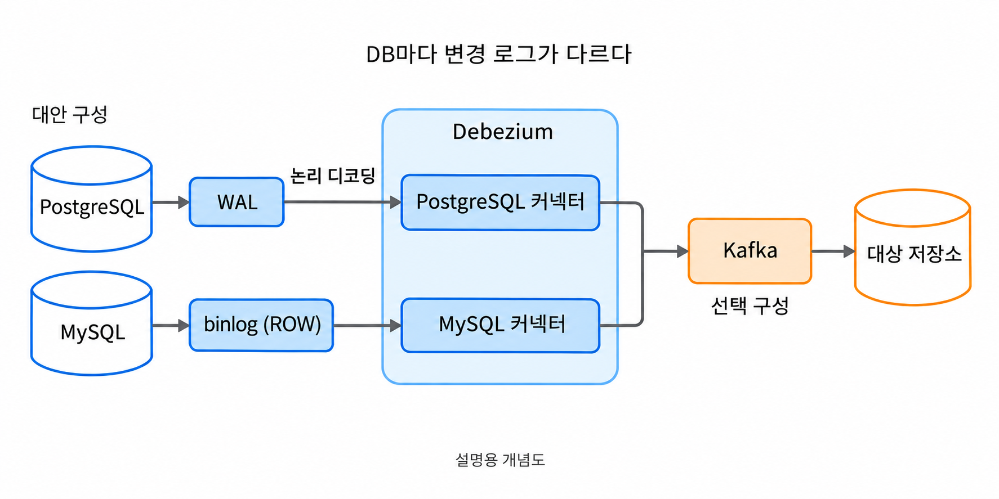
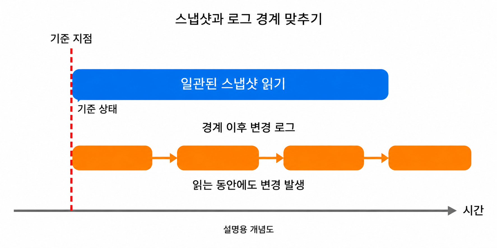
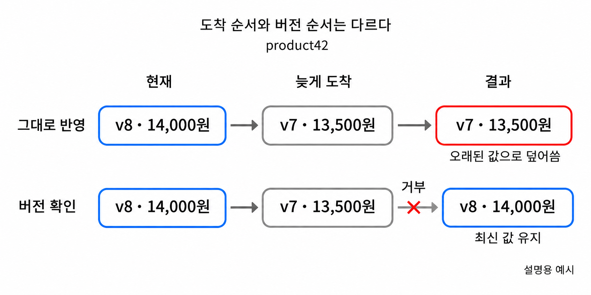
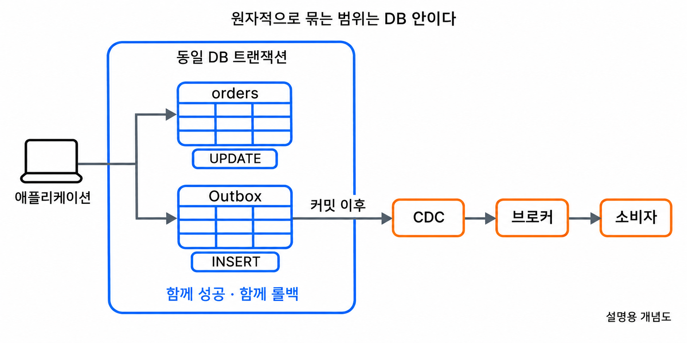

**CDC(Change Data Capture)**는 데이터베이스에서 발생하는 변경을 포착해 다른 시스템으로 전달하는 방식이다. 검색 색인, 캐시, 분석 저장소처럼 원본 데이터의 복사본을 사용하는 곳에서 변경분을 계속 따라가게 한다.

원본은 복사하는 동안에도 바뀌고, 변경을 전달하는 중간에 연결이 끊길 수 있다. 재전송으로 같은 변경이 두 번 도착하는 일도 생긴다. 수집한 변경을 목적지에 반영할 때는 이런 중단과 중복을 처리해야 한다.

처음 연결할 때는 기존 데이터를 가져오고 그 이후의 변경을 이어 읽는다. 중단되면 마지막 위치에서 다시 시작하고, 목적지에서는 변경 순서에 맞게 값을 갱신한다. **수집·전달·적용**의 각 단계에서 이 조건을 맞춰야 복사본을 최신 상태로 유지할 수 있다.

## 변경을 어디서 읽느냐에 따라 비용과 포착 범위가 달라진다

상품 테이블의 이름과 가격을 검색 시스템에도 유지한다고 가정한다. 상품이 바뀔 때마다 전체 테이블을 다시 복사할 수도 있지만, 일부 행만 달라졌는데 같은 데이터를 반복해서 읽게 된다. 변경분을 구분할 수 있다면 복사할 양을 줄이고 갱신 간격도 좁힐 수 있다.

가장 익숙한 접근은 일정 주기로 테이블을 조회하는 **폴링**이다. `updated_at`처럼 수정 시점을 나타내는 컬럼을 기준으로 지난 조회 이후 바뀐 행을 읽는다. 데이터베이스가 제공하는 일반적인 조회 기능으로 시작할 수 있다는 장점이 있다.

대신 변경을 나타내는 컬럼이 정확하게 관리되어야 한다. 수정할 때 시간이 갱신되지 않으면 조회에서 빠지고, 행을 실제로 삭제하면 다음 조회에는 그 행 자체가 없다. 같은 상품의 가격이 조회 사이에 여러 번 바뀌더라도 마지막 상태만 보일 수 있다.

증가하는 ID만으로 조회 범위를 정하면 기존 행의 수정도 발견하지 못한다. 시간과 ID를 함께 쓰거나 삭제 표시를 남기는 방식으로 보완할 수 있지만, 조회 조건만 정하면 모든 변경을 빠짐없이 얻는다고 가정해서는 안 된다. 인덱스와 조회 주기도 원본 데이터베이스의 부하에 영향을 준다.

트리거 기반 방식은 테이블에 변경이 생길 때 데이터베이스가 추가 동작을 실행하도록 한다. 상품이 수정되면 별도의 변경 기록 테이블에도 내용을 남기게 만들 수 있다. 삭제 전 정보를 기록하도록 설계하면 원본 행이 사라진 뒤에도 삭제 사실을 확인할 수 있다.

이 기록은 원본 변경과 같은 트랜잭션에 포함할 수 있다. 다만 매 쓰기 작업에 추가 로직과 기록 비용이 붙고, 테이블 구조가 바뀔 때 트리거도 함께 관리해야 한다. 변경 기록을 외부로 보내고 처리한 기록을 정리하는 작업도 남는다.

**로그 기반 CDC**는 데이터베이스가 복구와 복제에 사용하는 변경 기록을 활용한다. PostgreSQL의 WAL, MySQL의 binlog가 대표적인 출발점이다. 애플리케이션의 모든 쓰기 경로에 별도의 이벤트 발행 코드를 넣지 않고도 행 변경을 포착할 수 있다.

로그 기반 방식에서도 초기 데이터 읽기, 변경 로그 디코딩, 수집기가 읽을 때까지의 로그 보존이 원본에 부하를 준다. 테이블을 반복 조회하는 대신 이 작업들을 운영해야 한다.

| 항목 | 조회 기반 폴링 | 트리거 기반 | 로그 기반 CDC |
|---|---|---|---|
| 변경을 읽는 곳 | 현재 테이블의 조회 결과 | 트리거가 남긴 변경 기록 | 데이터베이스 변경 로그 |
| 수정 포착 | 수정 시각 등 조회 기준 필요 | 수정 트리거로 기록 | 지원되는 로그에서 포착 |
| 실제 삭제 포착 | 삭제 표시나 별도 기록 필요 | 삭제 시 기록하도록 설계 | 삭제 변경을 포착 |
| 중간 변경 이력 | 조회 사이의 상태를 놓칠 수 있음 | 기록하도록 설계한 변경을 보존 | 수집 대상 로그의 변경을 전달 |
| 원본의 주요 부담 | 반복 조회와 인덱스 접근 | 쓰기 경로의 추가 실행·저장 | 로그 디코딩·보존과 초기 읽기 |
| 관리 대상 | 조회 기준·주기·누락 방지 | 트리거·기록 테이블·전달 작업 | DB별 수집 설정·로그 보존·재시작 위치 |

최신 상태를 일정 주기로 맞추면 충분한지, 삭제와 중간 변경까지 필요한지에 따라 출발점이 달라진다. CDC라는 이름만으로 특정 구현 방식이나 지연 시간을 뜻하지는 않는다.

## Debezium은 변경을 읽고 Kafka는 변경을 보관하고 전달한다

### PostgreSQL — WAL을 논리 디코딩해 행 변경으로 읽는다

PostgreSQL에서 로그 기반 CDC를 구성할 때는 **WAL과 논리 디코딩**의 관계부터 구분해야 한다. WAL은 데이터베이스가 변경을 복구할 수 있도록 남기는 기록이다. 외부 프로그램이 이 파일을 그대로 읽는 것만으로 상품 ID와 새 가격이 담긴 이벤트를 얻는 것은 아니다.

논리 디코딩은 WAL에 담긴 정보를 외부에서 사용할 수 있는 논리적 변경으로 바꾸는 기능이다. 출력 플러그인이 이 변경을 정해진 형식으로 제공하고, CDC 커넥터가 복제 프로토콜을 통해 받아 처리한다.

복제 슬롯은 소비자가 변경을 이어 읽는 데 필요한 위치와 관련 자원을 관리한다. 이어 읽을 WAL이 지워지지 않도록 보존에도 영향을 준다.

### MySQL — binlog에 기록된 행 변경을 읽는다

MySQL에서 Debezium이 읽는 기록은 **binlog(binary log)**다. binlog는 데이터 변경을 이벤트로 남기며 복제와 백업 이후의 시점 복구에 사용된다. InnoDB가 장애 복구에 사용하는 redo log와는 별도의 기록이다.

PostgreSQL 커넥터는 WAL의 논리 디코딩 결과를 받고, MySQL 커넥터는 MySQL의 복제 프로토콜로 binlog 이벤트를 받아 해석한다.

binlog는 변경을 기록하는 형식도 구분한다. SQL 문장을 기록하는 방식과 바뀐 행을 기록하는 방식이 있으며, Debezium의 MySQL 커넥터는 **행 기반 기록인 `ROW` 형식**을 사용한다. 상품 가격을 수정했다면 어떤 SQL을 실행했는지만 전달하는 대신 해당 행의 변경을 읽는 방식이다.

Debezium을 구성할 때는 `binlog_format=ROW`와 `binlog_row_image=FULL` 등 커넥터가 요구하는 조건을 확인한다. 전자는 행 단위 기록을, 후자는 변경 이벤트에 담을 행 정보의 범위를 결정한다. binlog가 켜져 있다는 사실만으로 CDC에 필요한 조건이 모두 충족되는 것은 아니다.

이어 읽을 위치는 binlog 파일명과 파일 안의 위치 등으로 추적한다. GTID를 사용하는 구성에서는 트랜잭션 식별자 집합도 재개할 위치를 찾는 데 활용한다. 다만 위치를 알고 있어도 필요한 binlog가 이미 삭제됐다면 그 변경을 다시 읽을 수는 없다.

### 전달과 적용 — 커넥터 뒤에도 서로 다른 역할이 이어진다

**Debezium**은 데이터베이스별 커넥터를 제공하는 CDC 도구다. Kafka Connect 위에서 실행하는 일반적인 구성에서는 커넥터가 변경을 읽고 이벤트로 만들며, Kafka Connect가 커넥터 실행과 오프셋 저장 등 주변 기능을 맡는다. 오프셋은 중단 뒤 이어 읽을 위치를 나타내는 정보다.

Kafka는 이렇게 만들어진 이벤트를 토픽에 보관하고 소비자가 읽게 한다. 검색 색인 갱신과 분석 적재가 서로 다른 속도로 진행되더라도 각 소비자는 자신의 처리 위치를 관리할 수 있다. 이미 보관된 이벤트를 다시 읽는 것도 Kafka의 보존 정책이 허용하는 범위에서 가능하다.


_데이터베이스마다 변경을 읽는 경로가 다르고, 이후 전달과 반영은 별도 단계로 이어진다_

따라서 Kafka를 설치했다고 데이터베이스 변경이 자동으로 수집되지는 않는다. 반대로 CDC의 개념 자체가 Kafka를 필수로 요구하지도 않는다. Debezium에도 Kafka 없이 실행할 수 있는 구성이 있으므로 수집 도구와 전달 기반은 구별해서 선택한다.

목적지에 값을 쓰는 단계 역시 별도다. 소비자 애플리케이션이나 sink 커넥터가 이벤트를 읽어 검색 문서나 분석 테이블로 반영해야 한다. 수집기가 정상이라는 사실만으로 사용자가 보는 복사본까지 최신이라고 판단할 수는 없다.

원본의 한 트랜잭션에서 여러 행이나 테이블을 바꿔도 목적지에 모두 동시에 보인다는 보장은 없다. 변경 일부만 보이는 상태를 허용할 수 없다면 트랜잭션 경계를 이용한 묶음 적용 등 목적지의 원자성도 설계해야 한다.

## 초기 스냅샷과 변경 스트림은 같은 경계에서 이어져야 한다

이미 상품이 들어 있는 데이터베이스에 CDC를 처음 연결한다고 가정한다. 연결한 뒤 발생하는 변경만 읽으면 한동안 수정되지 않는 상품은 목적지에 나타나지 않는다. 처음에는 기존 데이터를 가져와 기준 상태를 만드는 과정이 필요하다.

이 과정이 **초기 스냅샷**이다. 기준 시점에 보이는 행의 상태를 읽는다. 과거의 모든 가격 변경이나 이미 삭제된 행을 복원하는 작업은 아니다.

스냅샷을 읽는 동안에도 원본은 계속 바뀐다. 테이블 복사를 끝낸 뒤 그때부터 변경을 수집하면, 복사 도중 발생한 변경을 놓칠 수 있다. 반대로 일관된 기준 없이 복사와 변경 적용을 섞으면 어떤 상태를 먼저 반영해야 하는지 불분명해진다.

그래서 스냅샷과 변경 로그의 **연결 지점**을 함께 확보해야 한다. PostgreSQL은 논리 복제 슬롯을 만들 때 변경 스트림과 연결되는 스냅샷을 제공할 수 있다. Debezium의 일반적인 초기 스냅샷 흐름도 일관된 데이터 상태를 읽은 뒤 연결된 로그 위치부터 스트리밍을 이어 간다.

MySQL 커넥터도 초기 상태를 읽을 때 대응하는 binlog 위치를 확보하고, 스냅샷 뒤 그 위치에서 변경 수집을 이어 간다. 이 과정의 잠금 방식과 일관성 확보 절차는 커넥터와 스냅샷 설정에 따라 다르다. 두 데이터베이스의 공통점은 테이블을 복사한 뒤 임의의 최신 위치로 뛰는 것이 아니라, 기준 상태와 이어 읽을 변경을 함께 정한다는 점이다.


_스냅샷을 읽는 동안의 변경도 보존해야 초기 상태와 이후 상태 사이에 누락이 생기지 않는다_

이 경계는 누락을 방지하기 위한 조건이지, 모든 구성에서 중복이 사라진다는 뜻은 아니다. 재시작이나 재전송으로 같은 이벤트를 다시 받을 수 있다는 점은 소비자 설계에서 별도로 다룬다. 스냅샷 방식과 격리 수준을 바꿀 때도 초기 상태의 일관성 조건을 확인해야 한다.

이벤트는 행의 값뿐 아니라 어떤 종류의 변경인지도 나타낸다. 아래 JSON은 PostgreSQL 커넥터의 상품 가격 수정 이벤트를 설명하기 위해 필드를 줄인 예시이며 실제 실행 결과가 아니다. 수정 전 값을 모두 사용할 수 있도록 `REPLICA IDENTITY FULL`을 설정했다고 가정하고, 스키마와 추가 메타데이터는 생략한다.

```json
{
  "before": { "id": 42, "price": 12000 },
  "after": { "id": 42, "price": 13500 },
  "source": { "schema": "public", "table": "products" },
  "op": "u"
}
```

이 예시는 상품 `42`의 가격이 12,000원에서 13,500원으로 수정된 상황을 나타낸다. Debezium의 대표적인 행 이벤트에서 `op`의 `c`는 생성, `u`는 수정, `d`는 삭제, `r`은 스냅샷으로 읽은 행을 뜻한다. 스냅샷의 `r`을 새 상품이 방금 생성되었다는 업무 사건으로 해석하면 안 된다.

`before`는 변경 전 정보, `after`는 변경 후 정보다. PostgreSQL에서 변경 전 어떤 컬럼을 받을 수 있는지는 `REPLICA IDENTITY` 설정 등에 달려 있으므로, 모든 이벤트에 전체 이전 행이 들어 있다고 가정해서는 안 된다. 소비자가 이전 값으로 차액을 계산한다면 이 조건이 특히 중요하다.

삭제 이벤트에서는 `after`가 `null`이 된다. 소비자는 이벤트 키 등으로 삭제 대상을 식별해 목적지에서도 제거하거나 삭제 상태를 남겨야 한다. 단순히 `after`가 있는 이벤트만 처리하면 원본에서 사라진 상품이 검색 결과에 계속 남을 수 있다.

Kafka의 **tombstone**은 이 삭제 이벤트와 구별한다. tombstone은 키가 있고 레코드 값 자체가 `null`인 메시지로, 로그 압축에서 해당 키의 이전 레코드를 정리하는 데 사용된다. Debezium은 설정에 따라 삭제 이벤트 뒤에 tombstone을 보낼 수 있으며, `after: null`인 객체와 메시지 값 전체가 `null`인 상태는 다르다.

## 중복과 순서가 뒤바뀌는 상황까지 목적지에서 처리해야 한다

소비자가 가격을 반영한 직후, 처리 위치를 저장하기 전에 종료되는 상황을 가정한다. 다시 시작한 소비자는 같은 이벤트를 읽을 수 있다. 이벤트를 받았다는 사실과 목적지 반영을 완료했다는 사실이 항상 하나의 원자적 작업으로 묶이는 것은 아니기 때문이다.

같은 이벤트를 여러 번 처리해도 결과가 같도록 만드는 성질이 **멱등성**이다. “가격을 13,500원으로 설정한다”는 작업은 단순한 상태 저장에서는 반복해도 같은 값이 된다. “기존 가격에 1,500원을 더한다”는 작업은 반복할 때마다 값이 달라진다.

검색 문서처럼 현재 상태를 저장하는 경우에는 기본 키 기준의 upsert가 도움이 된다. 행이 없으면 만들고 있으면 갱신하므로 동일한 행을 중복 생성하지 않는다. 하지만 upsert만으로 오래된 이벤트가 최신 값을 덮어쓰는 문제까지 해결되지는 않는다.

상품 가격이 13,500원에서 14,000원으로 바뀐 뒤 이전 이벤트가 늦게 적용되면, 단순 upsert는 다시 13,500원을 저장할 수 있다. Kafka는 파티션 안의 레코드 순서를 제공하지만 서로 다른 파티션 전체를 하나의 순서로 묶지는 않는다. 소비자가 비동기 작업을 병렬로 끝내는 방식도 실제 적용 순서에 영향을 준다.

같은 상품의 이벤트를 같은 키로 전달하고 키별 적용 순서를 유지하는 것이 한 가지 방법이다. 순서가 뒤바뀔 수 있는 경로에서는 마지막으로 반영한 버전보다 새로운 이벤트만 받아들이는 방식도 필요하다. 여기서 버전은 임의의 수신 시각이 아니라 해당 상품의 변경 순서를 비교할 수 있는 값이어야 한다.


_예전 가격 13,500원이 늦게 도착해도 버전을 확인하면 현재 가격 14,000원을 유지한다_

아래 SQL은 PostgreSQL을 목적지로 사용하는 개념 예시이며, 원본 애플리케이션이 상품을 수정할 때마다 `version`을 증가시킨다고 가정한다. `product_projection`에는 `id` 기본 키와 `price`, `version` 컬럼이 있고, 이벤트의 값이 각각 상품 `42`, 가격 14,000원, 버전 `8`이라고 가정한다. 목적지가 MySQL이라면 같은 버전 비교 원칙을 MySQL의 갱신 문법에 맞춰 구현해야 한다.

```sql
INSERT INTO product_projection (id, price, version)
VALUES (42, 14000, 8)
ON CONFLICT (id) DO UPDATE
SET price = EXCLUDED.price,
    version = EXCLUDED.version
WHERE product_projection.version < EXCLUDED.version;
```

이 구문은 저장된 버전보다 새 버전일 때만 가격을 바꾼다. 같은 버전의 재전송과 더 오래된 버전의 도착은 갱신하지 않는다. 이는 CDC가 자동으로 제공하는 업무 버전을 전제한 예제가 아니라, 순서 비교 기준을 명시적으로 설계했을 때의 적용 방식이다.

삭제에는 추가 주의가 필요하다. 목적지 행과 버전까지 모두 지우면 늦게 온 이전 수정 이벤트가 행을 다시 만들 수 있다. 삭제 버전을 별도로 보관하거나, 재처리 범위 안에서 삭제 표시를 유지하는 등 오래된 이벤트를 거부할 정보가 남아야 한다.

주문 금액 집계처럼 반복 실행 자체가 결과를 바꾸는 작업이라면 이벤트 ID로 처리 여부를 기록하는 방식이 더 적합할 수 있다. 이 경우 처리 기록과 실제 데이터 변경을 같은 트랜잭션에 묶어야 “처리했다는 기록만 남음”과 “반영했지만 기록은 없음” 사이의 틈을 줄일 수 있다. 외부 API 호출까지 포함되면 그 API가 제공하는 중복 방지 수단도 함께 고려한다.

### 운영 경계 — 수집 지연과 적용 지연은 서로 다른 문제다

PostgreSQL에서 변경을 가져오는 속도가 느려지면 복제 슬롯 때문에 필요한 WAL이 계속 남을 수 있다. 보존 제한 없이 지연이 누적되면 원본 디스크를 압박한다. 반대로 보존 한도를 두어 필요한 로그가 사라지면 저장된 위치부터 이어 읽지 못해 재초기화가 필요할 수 있다.

MySQL에서는 binlog의 보존 기간과 수집기의 읽기 위치를 함께 확인한다. PostgreSQL 복제 슬롯의 동작이 MySQL에도 그대로 적용되는 것은 아니며, CDC 수집기가 중단된 동안 필요한 binlog가 만료되거나 수동으로 삭제될 수 있다. 보존 범위는 평소 지연뿐 아니라 장애 복구와 밀린 변경을 따라잡는 시간까지 고려해야 한다.

그래서 커넥터의 실행 여부만 확인하지 않고 수집 위치, DB별 로그 보존량과 다시 읽을 수 있는 범위, 원본 디스크 여유를 함께 본다. Kafka까지 전달이 끝났더라도 목적지 소비자가 뒤처지면 사용자가 보는 데이터는 오래된 상태다. 수집 지연과 목적지 적용 지연을 구별해야 어느 단계가 막혔는지 알 수 있다.

스키마를 바꿀 때는 소비자가 새 형식의 데이터를 읽을 수 있는지도 확인해야 한다. 원본에서 컬럼을 삭제하거나 타입을 바꾸는 순간 소비자의 역직렬화와 목적지 쓰기가 실패할 수 있다. PostgreSQL의 논리 복제는 DDL을 그대로 목적지에 적용해 주는 기능이 아니므로, 데이터 변경 전달을 스키마 배포 자동화와 동일하게 취급해서는 안 된다.

필드를 추가할 때는 기존 소비자가 이를 무시하거나 기본값으로 처리할 수 있는지 확인한다. 필드를 없앨 때는 소비자가 더 이상 사용하지 않도록 먼저 바꾸는 식으로 배포 순서를 조정한다. 이벤트 형식과 목적지 구조를 함께 관리해야 재처리하는 오래된 데이터도 해석할 수 있다.

## 업무 이벤트가 필요하면 Outbox와 CDC의 역할을 결합한다

상품 테이블의 행 변경은 검색 문서를 갱신하는 데 자연스럽게 연결된다. 하지만 주문 테이블의 `status` 컬럼이 바뀌었다는 사실만으로 모든 소비자가 “결제가 승인되었다”는 업무 의미를 안정적으로 해석할 수 있는 것은 아니다. 같은 컬럼이 관리자 수정이나 데이터 보정 과정에서도 바뀔 수 있기 때문이다.

일반 테이블의 CDC 이벤트는 저장 구조와 가깝다. 소비자가 컬럼 조합으로 업무 사건을 추론하면 원본 테이블 구조가 바뀔 때 소비자도 영향을 받는다. 어떤 사건이 발생했고 어떤 정보를 외부에 공개할지는 애플리케이션이 명시하는 편이 적합한 경우가 있다.

**Transactional Outbox**는 업무 데이터 변경과 발행할 이벤트 기록을 같은 데이터베이스 트랜잭션에 저장하는 패턴이다. 주문 상태를 바꾸면서 Outbox 테이블에 `OrderPaid` 같은 이벤트를 함께 넣는다. 트랜잭션이 롤백되면 둘 다 취소되고, 커밋되면 이벤트를 전달할 기록도 남는다.

그다음 별도의 전달기가 Outbox를 읽어 브로커에 보낸다. 이 전달기를 로그 기반 CDC로 구현할 수 있으며, Debezium의 Outbox Event Router는 Outbox 행을 외부에 보낼 이벤트 형태로 변환하고 라우팅하는 데 사용한다. 업무 이벤트를 결정하는 책임은 애플리케이션에, 커밋된 기록을 전달하는 책임은 CDC에 둔다.


_업무 변경과 이벤트 기록은 함께 커밋되지만 외부 전달과 소비자 처리는 그 트랜잭션 밖에 있다_

Outbox를 쓰더라도 브로커 전달과 소비자 실행이 자동으로 한 번만 일어나는 것은 아니다. 고유 이벤트 ID를 두고 소비자가 중복을 처리해야 하며, 같은 주문의 순서를 유지할 키도 정해야 한다. Outbox는 업무 변경과 이벤트 기록이 함께 남는 문제를 해결하고, 이후 전달과 적용의 조건은 계속 관리한다.

| 선택 기준 | 주기적인 테이블 조회 | 일반 테이블의 로그 기반 CDC | Outbox와 로그 기반 CDC |
|---|---|---|---|
| 주로 필요한 결과 | 일정 간격의 최신 상태 | 행의 생성·수정·삭제 동기화 | 명시적인 업무 사건 전달 |
| 외부에 보이는 모델 | 조회 결과와 컬럼 | 원본 테이블과 행 변경 | 애플리케이션이 정한 이벤트 |
| 애플리케이션 변경 | 조회 기준 컬럼 관리 등이 필요할 수 있음 | 쓰기 경로 변경을 줄일 수 있음 | 업무 트랜잭션에 이벤트 기록 추가 |
| 주요 설계 과제 | 누락·삭제 감지와 조회 부하 | 스냅샷 경계·로그 보존·목적지 적용 | 이벤트 계약·ID·순서·Outbox 관리 |
| 잘 맞는 조건 | 일정 지연과 중간 상태 생략을 허용 | 원본 상태를 다른 저장소에 계속 반영 | 다른 서비스가 업무 의미로 반응 |

수집 방식을 고를 때는 허용할 수 있는 지연, 중간 변경과 삭제의 필요성, 외부에 공개할 데이터 모델을 먼저 정한다. 그다음 원본에서 가능한 권한과 로그 보존 조건, 장애 뒤 따라잡을 수 있는 범위를 맞춘다.

## 마무리

CDC는 데이터베이스의 변경을 외부 시스템이 따라갈 수 있는 흐름으로 만든다. 폴링, 트리거, 로그 기반 방식은 변경을 발견하는 위치가 다르며, 각각의 포착 범위와 원본 부담을 기준으로 선택한다.

로그 기반 CDC에서도 초기 스냅샷과 스트림의 연결, 중단 뒤 재시작, 목적지의 중복·순서·삭제 처리가 필요하다. Debezium과 Kafka가 제공하는 기능을 연결하되, 최종 상태를 반영하는 소비자의 책임까지 포함해야 동기화가 성립한다.

복사하려는 것이 행의 상태인지 업무 사건인지도 구분해야 한다. 행의 상태가 필요하면 일반 테이블 CDC가 자연스럽고, 업무 의미를 안정적인 계약으로 전달하려면 Outbox와 CDC를 결합할 수 있다.
